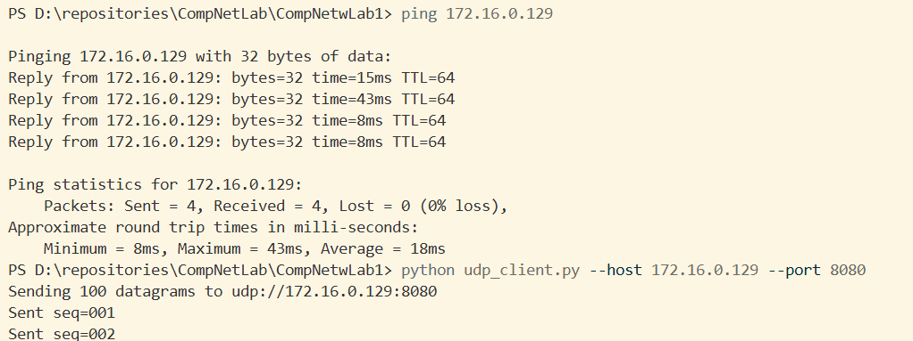
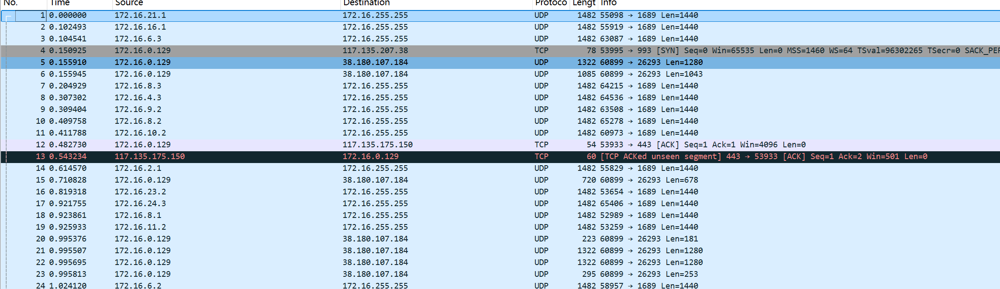
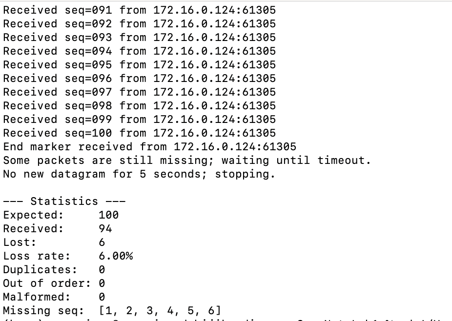
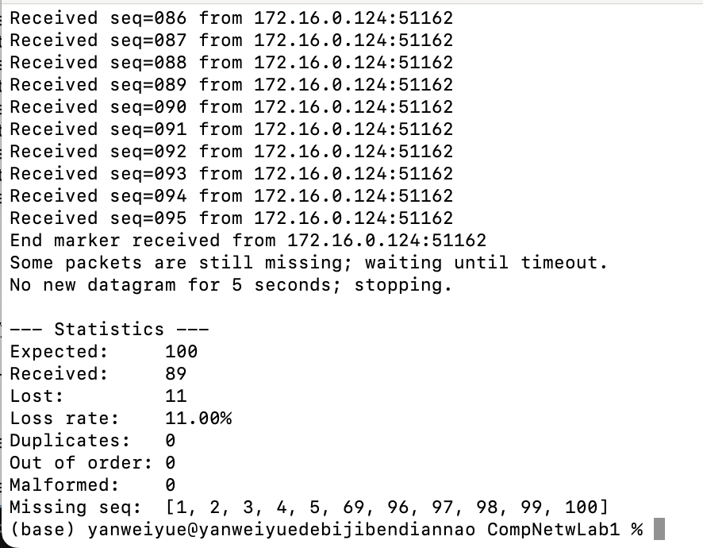

# 网络编程实验报告


## 小组成员信息

| 角色 | 学号 | 姓名 | 自评分（百分制） |
| :--- | :--- | :--- | :--- |
| 组长 | 24325288 | 闫维岳 | 90 |
| 组员 | 24325237 | 苏文韬 | 80 |
| 组员 | 24325286 | 薛淞 | 80 |

---

## 一、实验目的

1. 理解套接字（Socket）网络编程的基本原理与 C/S 工作模式。
2. 掌握 UDP（用户数据报协议）无连接通信的特点与编程方法。
3. 通过连续发送 100 个数据包并在接收端统计丢失情况，直观认识 UDP 的不可靠性（丢包、乱序、重复）。
4. 学会使用 Wireshark 对通信数据包进行跟踪分析。

## 二、实验环境

| 项目 | 内容 |
| :--- | :--- |
| 操作系统 | Windows 11 |
| 编程语言 | Python 3.13 / C++（Winsock2，链接 `ws2_32.lib`） |
| 开发工具 | 文本编辑器 + 命令行；C++ 使用 MinGW/GCC 或 MSVC 编译 |
| 抓包工具 | Wireshark（回环抓包使用 Npcap Loopback Adapter） |
| 网络环境 | 本机回环地址 `127.0.0.1`，端口 `8080`（Python）/ `2000`（C++） |

## 三、实验内容与要求

【实验内容】
1. 编写 UDP 通信程序：发送端通过循环连续发送 100 个数据包，每个数据包带有序号；接收端统计丢失的数据包。
2. 实验时运行 Wireshark，对通信过程的数据包进行跟踪分析。

【实验要求】
1. 回答《网络编程实验指导手册》实验 1 中的 7 个"实验思考"。
2. 实验报告中简述设计思路。

## 四、设计思路

### 4.1 总体设计

本实验采用典型的 **客户端/服务器（C/S）** 结构：客户端（发送端）作为主动方，向服务器连续发送带序号的数据报；服务器（接收端）作为被动方，绑定本地端口后循环接收并统计。

- **数据报文格式**：每个数据报包含类型 `type`、序号 `seq` 与发送时间戳。序号从 1 开始，用于判断丢包、重复与乱序。
- **结束判定**：UDP 无连接、无内建结束标志，因此客户端额外发送一个 `type="end"` 的结束标记；服务器在收到首包后启动接收超时计时，超时未收到新包即判定发送结束。
- **统计方法**：服务器用集合保存已收到的序号，通过"期望序号集合 − 实际收到集合"得到丢失序号，并单独统计重复包、乱序包与格式错误包。

同时实现 Python 与 C++（Winsock）两个版本：Python 版便于快速验证；C++ 版演示 Windows 下 Winsock 的标准编程流程（`WSAStartup`/`WSACleanup`、`sockaddr_in`、网络字节序等）。

### 4.2 客户端流程图

```text
                开始
                 │
                 ▼
        解析命令行参数 (host/port/count/interval)
                 │
                 ▼
        创建 UDP 套接字  socket(AF_INET, SOCK_DGRAM)
                 │
                 ▼
        ┌──────────────────────────┐
        │ for seq in 1 .. count    │
        │   构造报文 {type, seq,    │
        │            sent_ns}      │
        │   sendto(报文, (host,port))│
        │   若 interval>0 则 sleep │
        └──────────────────────────┘
                 │
                 ▼
        发送结束标记 {type:"end", count}
                 │
                 ▼
        关闭套接字，结束
```

### 4.3 服务器端流程图

```text
                开始
                 │
                 ▼
      创建 UDP 套接字并 bind 到 (host, port)
                 │
                 ▼
        ┌─► 循环 recvfrom() 接收数据报
        │        │
        │        ├─ 超时 → 跳出循环（判定发送结束）
        │        ▼
        │    解析 JSON 报文
        │        ├─ 解析失败 → malformed++，继续
        │        ▼
        │    判断 type
        │        ├─ "end" → 已收齐则结束；否则继续等超时
        │        └─ "data" → 校验 seq：
        │              ├─ seq 已收到      → duplicates++
        │              ├─ seq < 最大序号  → out_of_order++
        │              └─ 否则更新最大序号
        │              received.add(seq)
        └────────┘
                 │
                 ▼
        输出统计结果 (Expected/Received/Lost/Loss rate/...)
```

### 4.4 关键函数说明

**Python 版**

| 函数 | 功能 |
| :--- | :--- |
| `socket.socket(AF_INET, SOCK_DGRAM)` | 创建 IPv4 的 UDP 数据报套接字 |
| `bind((host, port))` | 服务器端将套接字绑定到本地 IP 与端口 |
| `sendto(data, addr)` | 无连接发送一个完整数据报到指定地址 |
| `recvfrom(bufsize)` | 阻塞接收一个数据报，返回数据与对端地址 |
| `settimeout(t)` | 设置接收超时，超时抛出 `socket.timeout` |

**C++（Winsock）版**

| 函数 | 功能 |
| :--- | :--- |
| `WSAStartup(MAKEWORD(2,2), &wsaData)` | 初始化并加载 Winsock 2.2 库 |
| `socket(AF_INET, SOCK_DGRAM, 0)` | 创建 UDP 数据报套接字 |
| `bind(sock, (sockaddr*)&addr, len)` | 服务器端绑定本地地址与端口 |
| `sendto(...)` / `recvfrom(...)` | 无连接发送 / 接收数据报 |
| `setsockopt(..., SO_RCVTIMEO, ...)` | 设置接收超时，用于判断发送结束 |
| `closesocket(sock)` / `WSACleanup()` | 关闭套接字 / 卸载 Winsock 库 |

## 五、实验步骤与输入指令

1. **启动服务器**（终端 1）：
   ```bash
   # Python 版
   py udp_server.py
   # 或 C++ 版（默认端口 2000）
   ./udp_server.exe
   ```
   出现 `Listening on udp://127.0.0.1:8080` 后保持运行（`recvfrom()` 正在阻塞等待数据，并非卡死）。

2. **启动 Wireshark**（可选）：选择 `Npcap Loopback Adapter` 网卡开始抓包，显示过滤器设为 `udp && udp.port == 8080`。

3. **启动客户端**（终端 2）：
   ```bash
   # Python 版
   py udp_client.py
   # 快速连续发送（包间不等待）
   py udp_client.py --interval 0
   # C++ 版
   ./udp_client.exe 127.0.0.1 2000 100
   ```

4. **观察结果**：客户端发送完毕后，服务器端输出统计结果。

5. **（可选）两台电脑测试**：服务器监听 `0.0.0.0`，客户端 `--host` 指向服务器局域网 IP，并确保防火墙放行对应 UDP 端口。

## 六、关键代码

### 6.1 Python 客户端（`udp_client.py`）

```python
# 报文编码：JSON 转 UTF-8 字节，去掉多余空格使载荷更紧凑
def encode(message):
    return json.dumps(message, separators=(",", ":")).encode("utf-8")

with socket.socket(socket.AF_INET, socket.SOCK_DGRAM) as client:
    destination = (args.host, args.port)
    for seq in range(1, args.count + 1):           # 序号 1..100
        message = {"type": "data", "seq": seq, "sent_ns": time.time_ns()}
        client.sendto(encode(message), destination)
        if args.interval > 0:
            time.sleep(args.interval)
    # UDP 无结束标志，额外发送 type=end 结束标记
    client.sendto(encode({"type": "end", "count": args.count}), destination)
```

### 6.2 Python 服务器端（`udp_server.py`）

```python
with socket.socket(socket.AF_INET, socket.SOCK_DGRAM) as server:
    server.bind((args.host, args.port))
    while True:
        try:
            data, peer = server.recvfrom(65535)
            server.settimeout(args.timeout)        # 首包到达后开始超时计时
        except socket.timeout:
            break
        message = json.loads(data.decode("utf-8"))
        if message.get("type") == "end":
            if expected <= received: break         # 全部收齐，立即结束
            continue                               # 未收齐，继续等晚到包
        seq = message.get("seq")
        if seq in received:      duplicates += 1
        elif seq < highest_seq:  out_of_order += 1
        else:                    highest_seq = seq
        received.add(seq)
# 最终统计：expected - received 得到丢失序号，并计算丢包率
```

### 6.3 C++ 客户端（`cpp/udp_client.cpp`）

```cpp
if (WSAStartup(MAKEWORD(2, 2), &wsaData) != 0) { /* 错误处理 */ }
SOCKET sock = socket(AF_INET, SOCK_DGRAM, 0);

struct sockaddr_in serverAddr;
memset(&serverAddr, 0, sizeof(serverAddr));
serverAddr.sin_family = AF_INET;
serverAddr.sin_port   = htons(port);            // 端口 → 网络字节序
serverAddr.sin_addr.s_addr = inet_addr(host);   // IP → 网络字节序

for (int i = 1; i <= count; i++) {
    Packet pkt;
    pkt.seq = i;
    sprintf(pkt.data, "hello UDP, packet %d", i);
    sendto(sock, (const char*)&pkt, sizeof(pkt), 0,
           (struct sockaddr*)&serverAddr, sizeof(serverAddr));
}
closesocket(sock); WSACleanup();
```

### 6.4 C++ 服务器端（`cpp/udp_server.cpp`）

```cpp
SOCKET sock = socket(AF_INET, SOCK_DGRAM, 0);
struct sockaddr_in serverAddr;
serverAddr.sin_family      = AF_INET;
serverAddr.sin_addr.s_addr = htonl(INADDR_ANY); // 绑定本机所有网卡
serverAddr.sin_port        = htons(port);
bind(sock, (struct sockaddr*)&serverAddr, sizeof(serverAddr));

int timeout = RECV_TIMEOUT_MS;                  // 5000ms 接收超时
setsockopt(sock, SOL_SOCKET, SO_RCVTIMEO, (const char*)&timeout, sizeof(timeout));

int *received = new int[total + 1]();           // received[i]=1 表示序号 i 已收到
while (recvCount < total) {
    Packet pkt;
    recvfrom(sock, (char*)&pkt, sizeof(pkt), 0,
             (struct sockaddr*)&clientAddr, &clientAddrLen);
    if (pkt.seq >= 1 && pkt.seq <= total && !received[pkt.seq]) {
        received[pkt.seq] = 1; recvCount++;     // 只计有效且未重复的序号
    }
}
// 丢包数 = total - recvCount，并输出丢包率与丢失序号
```

## 七、实验结果与 Wireshark 分析

### 7.1 运行输出

客户端发送完成后，服务器端输出如下（本机回环测试）：

```text
Listening on udp://127.0.0.1:8080
Waiting for 100 numbered datagrams ...
...
--- Statistics ---
Expected:     100
Received:     100
Lost:         0
Loss rate:    0.00%
Duplicates:   0
Out of order: 0
Malformed:    0
Missing seq:  none
```



### 7.2 Wireshark 抓包分析

本机回环测试中，Wireshark 通常能捕获到 **101 个 UDP 数据报**：100 个实验数据报 + 1 个 `end` 结束标记。统计数据报时只计前 100 个。

| 观察项 | 说明 |
| :--- | :--- |
| 源/目的地址 | 均为 `127.0.0.1`（回环），无物理链路参与 |
| 协议 | UDP |
| 目的端口 | `8080`（Python 版） |
| 数据报个数 | 101（100 个数据 + 1 个 end 标记） |



由于回环链路不经过真实网络，理论上不会丢包，因此本机测试结果丢包率为 0%；丢包现象主要在跨主机、跨网络或高速发送时出现（见"实验思考 7"）。

### 7.3 双机测试（跨主机）与丢包

将两台电脑接入同一局域网，服务器监听 `0.0.0.0:8080`，客户端指向服务器的局域网 IP 连续发送 100 个数据报。由于数据报经过真实链路与交换设备，出现了 UDP 丢包，接收端输出如下：

**接收率 94%**（100 个中收到 94 个，丢包 6 个）：



**接收率 89%**（100 个中收到 89 个，丢包 11 个）：



两次测试的接收率分别为 94% 与 89%，丢包率约 6% 与 11%，与回环测试 0% 丢包形成对比，直观验证了 UDP 跨主机传输时的不可靠性（丢包原因分析见"实验思考 7"）。

Wireshark 抓包文件（双机测试 100 个数据报）：[双机测试_100包.pcapng](双机测试_100包.pcapng)

## 八、实验思考

### 8.1 实验过程中遇到的问题和解决方法

1. **服务器打印 `Listening` 后"无反应"** —— 这是 `recvfrom()` 在阻塞等待数据，并非程序卡死。解决：先启动服务器，再启动客户端；服务器终端需保持运行。
2. **UDP 无连接、无结束标志，服务器无法判断客户端何时发完** —— 自定义 `type="end"` 结束标记；同时服务器在收到首包后设置接收超时（默认 5s），超时未收到新包即结束，避免丢包时永久等待。
3. **C++ 程序调用 socket 函数返回 `SOCKET_ERROR`（错误码 `WSANOTINITIALISED`）** —— Windows 下未先加载 Winsock 库。解决：任何 Winsock 调用前先执行 `WSAStartup(MAKEWORD(2,2), &wsaData)`，程序结束前调用 `WSACleanup()`。
4. **`bind` 失败 / 端口被占用** —— 换用 2000 以上的端口，或关闭占用该端口的进程。
5. **两台电脑测试时收不到数据** —— 防火墙拦截了 UDP 端口。解决：服务器监听 `0.0.0.0`，客户端指向服务器局域网 IP，并在防火墙中放行对应 UDP 端口。

### 8.2 程序流程图与关键函数说明

客户端与服务器端完整流程图见第四节（4.2、4.3），关键函数说明见 4.4 节。核心函数概括如下：

| 函数 | 作用 |
| :--- | :--- |
| `WSAStartup` / `WSACleanup` | Windows 下初始化 / 卸载 Winsock 库 |
| `socket()` | 创建套接字（UDP 用 `SOCK_DGRAM`） |
| `bind()` | 服务器端将套接字绑定到本地 IP 与端口 |
| `sendto()` / `recvfrom()` | UDP 无连接的数据报发送 / 接收 |
| `closesocket()` | 关闭套接字、释放资源 |

### 8.3 客户端与服务器使用的不同函数及 `struct sockaddr *addr` 参数含义

**使用的函数差异**：客户端使用 `socket()` → `sendto()`（发送）/ `recvfrom()`（如需要接收应答）→ `closesocket()`；服务器端使用 `socket()` → `bind()` → `recvfrom()` / `sendto()` → `closesocket()`。UDP 无连接，双方都**不需要** `listen()`、`accept()`、`connect()`（连接建立类函数）。

**`struct sockaddr *addr` 参数含义**：`bind()`、`connect()`、`sendto()` 等函数的地址参数是一个指向通用地址结构 `sockaddr` 的指针，实际使用时传入 `sockaddr_in` 并强制类型转换。两者长度均为 16 字节，可互相转换。

```c
struct sockaddr_in {                  struct sockaddr {
    short  sin_family;    // 地址族   u_short sa_family;  // 地址族
    u_short sin_port;     // 端口(2B) char sa_data[14];   // 地址+端口(14B)
    struct in_addr sin_addr; // IP(4B)
    char   sin_zero[8];   // 预留(8B) }；
};                                   // 共 16 字节
```

| 字段 | 含义 | 示例（`127.0.0.1:8080`） |
| :--- | :--- | :--- |
| `sin_family` | 地址族，IPv4 用 `AF_INET` | `AF_INET`（值 2） |
| `sin_port` | 端口号，**网络字节序** | `htons(8080)` = `0x1F90` |
| `sin_addr` | IP 地址，**网络字节序** | `inet_addr("127.0.0.1")` = `0x7F000001` |
| `sin_zero` | 8 字节预留，填 0 | `0x00` × 8 |

> 说明：主机字节序与网络字节序可能不同，因此端口用 `htons()`、IP 用 `inet_addr()`/`htonl()` 转换为网络字节序（大端序）。

### 8.4 面向连接与面向非连接的客户端在建立 Socket 时的区别

| 对比项 | 面向连接（TCP）客户端 | 面向非连接（UDP）客户端 |
| :--- | :--- | :--- |
| 创建套接字 | `socket(AF_INET, SOCK_STREAM, 0)` | `socket(AF_INET, SOCK_DGRAM, 0)` |
| 是否 `connect()` | 必须调用 `connect()`，完成三次握手、建立逻辑连接 | 可不调用，直接用 `sendto()` 指定目的地址发送 |
| 通信前状态 | 建立连接后才可收发数据 | 无需连接，随时可发送 |
| 套接字属性 | 面向连接的字节流套接字 | 无连接的数据报套接字 |

### 8.5 面向连接与面向非连接在收发数据时的区别，及非连接如何判断发送结束

**收发数据的区别**：

| 对比项 | TCP（面向连接） | UDP（面向非连接） |
| :--- | :--- | :--- |
| 收发函数 | `send()` / `recv()` | `sendto()` / `recvfrom()` |
| 是否需指定地址 | 连接已建立，收发无需再指定对端地址 | 每次 `sendto()` 都需指定目的地址，`recvfrom()` 返回来源地址 |
| 数据形态 | 字节流，无边界，可能粘包/拆包 | 独立数据报，每个报文完整、有边界 |
| 可靠性 | 可靠、有序、无丢失重复 | 不可靠，可能丢包、乱序、重复 |

**非连接客户端如何判断数据发送结束**：UDP 无连接、无"关闭连接"通知，程序无法靠协议本身判断对方是否发完。本实验采用两种手段：
1. 客户端在全部数据报发完后，额外发送一个 `type="end"` 的结束标记，服务器据此知道发送完毕；
2. 服务器端在收到第一个包后启动接收超时（如 5 秒），超时未收到新包即判定本轮发送结束——这样即使 `end` 标记丢失，也不会永久等待。

### 8.6 面向连接通信与无连接通信的比较

| 对比项 | 面向连接（TCP） | 无连接（UDP） |
| :--- | :--- | :--- |
| 优点 | 可靠、有序、无重复，含流量与拥塞控制，数据完整交付 | 开销小（头部仅 8 字节）、无需建连、速度快、支持广播/多播 |
| 缺点 | 需三次握手建立连接、维护状态，头部 20 字节，开销大、时延高 | 不可靠：可能丢包、乱序、重复，无拥塞控制 |
| 适用场合 | 文件传输、网页浏览、电子邮件等要求数据完整可靠的场景 | 实时音视频、DNS 查询、在线游戏、直播等容忍少量丢失、追求低时延的场景 |

### 8.7 发送更多包时的丢包现象及 UDP 丢包的可能原因

尝试增大发包数（如 1000、10000 包）并以 `--interval 0` 高速连续发送时，可能出现丢包。引起 UDP 丢包的可能原因：

1. **接收端缓冲区溢出**：发送速率超过接收端处理速度，套接字接收缓冲区（socket receive buffer）被填满，后续到达的包被内核丢弃。
2. **网络拥塞**：路由器或中间节点队列满时主动丢弃数据报，这是 UDP 无拥塞控制导致的必然结果。
3. **链路质量**：无线网络干扰、信号衰减、误码等导致数据报损坏被丢弃。
4. **MTU 分片**：数据报超过链路 MTU 被分片，任一分片丢失则整个数据报不可用。
5. **防火墙 / 安全策略**：中间防火墙对 UDP 流量限流或直接丢弃。
6. **操作系统调度**：CPU 忙时应用层来不及及时调用 `recvfrom()` 取走数据，导致缓冲区溢出。

> 本机回环测试通常不丢包（数据不经真实网络、缓冲区足够大）；丢包主要在跨主机、跨网络或高速发送时出现。

## 九、遇到的问题及解决方法（汇总）

| 问题 | 现象 | 解决方法 |
| :--- | :--- | :--- |
| 误以为服务器卡死 | 打印 `Listening` 后无输出 | 理解 `recvfrom()` 阻塞等待，先启服务器再启客户端 |
| 无法判断发送结束 | 服务器一直等待 | 自定义 `end` 标记 + 接收超时 |
| Winsock 未初始化 | `SOCKET_ERROR` / `WSANOTINITIALISED` | 先 `WSAStartup`，结束 `WSACleanup` |
| 端口被占用 | `bind` 失败 | 改用 2000 以上端口或释放占用进程 |
| 跨机收不到数据 | 防火墙拦截 UDP | 服务器监听 `0.0.0.0`，放行对应 UDP 端口 |

## 十、实验完成情况

1. 已完成 UDP 客户端 / 服务器端程序设计（Python 与 C++ 两个版本）。
2. 已实现连续发送 100 个数据包并在接收端统计丢失、重复、乱序与格式错误。
3. 已使用 Wireshark 对回环通信进行抓包分析，确认捕获 100 个数据报 + 1 个结束标记。
4. 已完整回答实验 1 的 7 个实验思考。

## 十一、改进建议

1. **延迟统计**：报文已携带 `sent_ns` 时间戳，可进一步计算单程时延与抖动。
2. **丢包率自动化**：可对不同发包数、发送间隔做批量对比，绘制丢包率曲线。
3. **加入重传机制**：对丢失的序号请求重传，验证"可靠 UDP"的可行性。
4. **跨平台封装**：将 Winsock 与 POSIX socket 差异封装，使 C++ 代码在 Windows/Linux 间可移植。
5. **图形化界面**：可增加 GUI 或图表，更直观展示丢包率与到达顺序。

## 十二、总结

本次实验完成了 UDP 网络通信程序的设计、编码、运行与抓包分析。通过实现客户端连续发送 100 个数据报、服务器端统计丢失的完整流程，深入理解了 Socket 编程中 C/S 结构与 UDP 无连接通信的特点。

1. **UDP 编程**：掌握了 `socket`/`bind`/`sendto`/`recvfrom` 等函数的使用，以及 `struct sockaddr_in` 与网络字节序的处理。
2. **无连接协议特性**：理解了 UDP 可能丢包、乱序、重复，以及无内建结束标志，需靠应用层自定义结束标记与超时来判定结束。
3. **面向连接 vs 无连接**：明确了 TCP 与 UDP 在建立连接、收发数据、可靠性等方面的区别及各自适用场景。
4. **工程实践**：熟悉了 Windows 下 Winsock 编程（`WSAStartup`/`WSACleanup`）与 Wireshark 抓包分析方法，为后续 TCP 实验打下基础。
