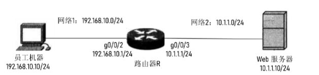
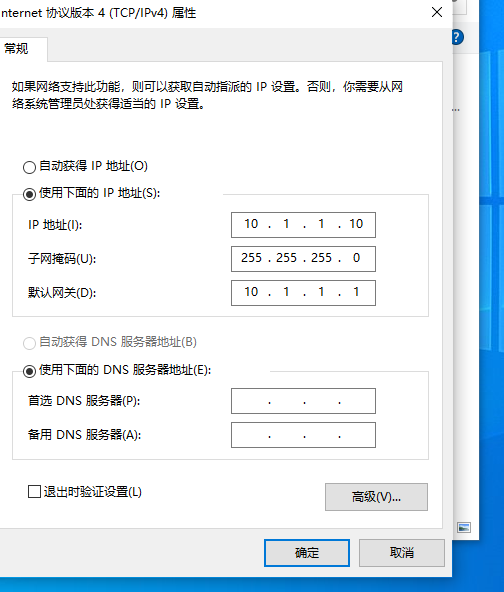
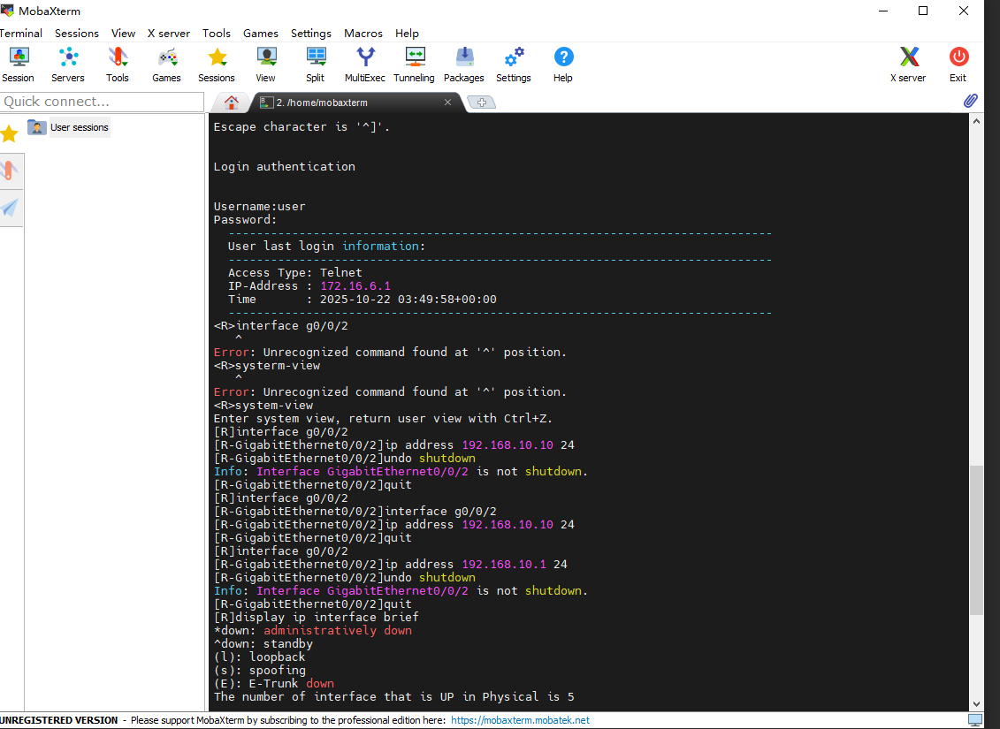
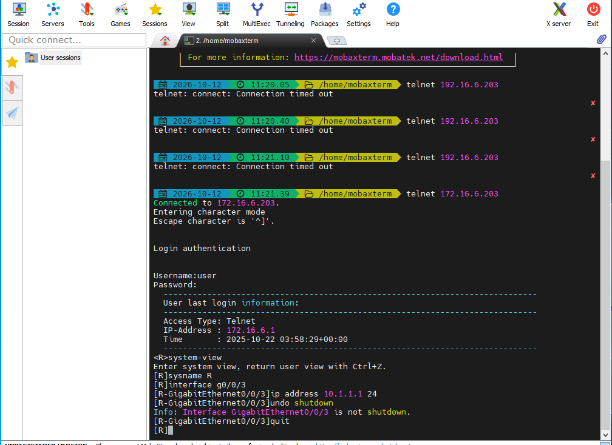
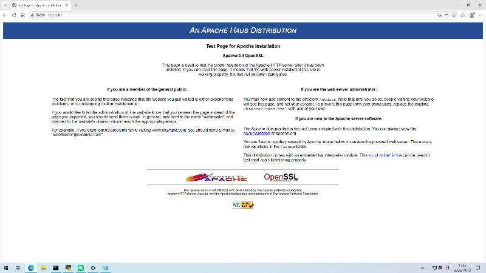
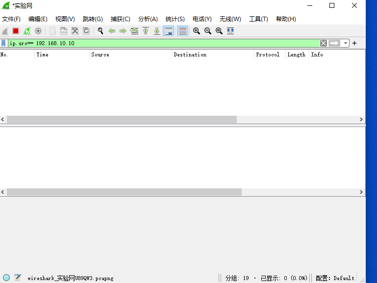
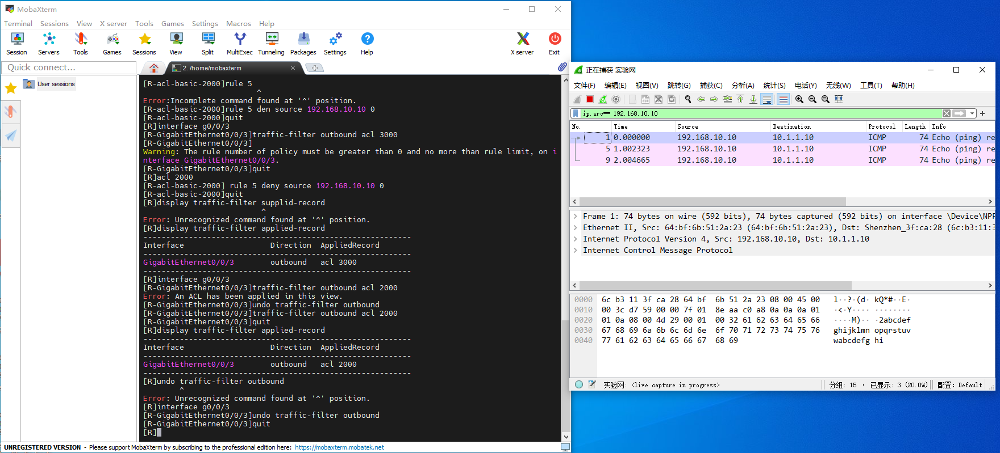
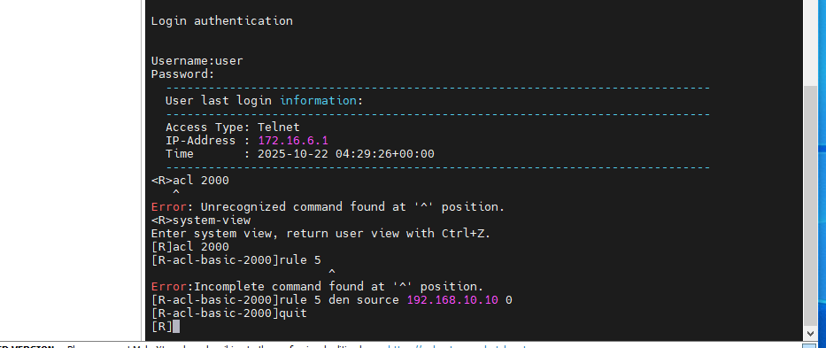

# 实验 2：访问控制列表实验报告（组号 6）

## 成员信息

| 角色 | 姓名 | 学号 | 自评分 |
| :--- | :--- | :--- | :--- |
| 组长 | 闫维岳 | 24325288 | 本次实验请假缺席，已交请假单 |
| 组员 | 苏文韬 | 24325237 | 90 |
| 组员 | 薛淞 | 24325286 | 90 |
| 组员 | 李伟龙 | 24325144 | 90 |

## 一、实验目的

- 在路由器上配置基于 ACL 的访问控制，实现员工机对 Web 服务器的访问限制。
- 理解基本 ACL（2000~2999）与高级 ACL（3000~3999）的区别。
- 掌握 ACL 的配置、应用、验证方法，以及 Wireshark 抓包验证 ACL 生效。

## 二、实验拓扑与设备



| 设备 | IP 地址 | 网关 | 连接 |
| :--- | :--- | :--- | :--- |
| 员工机 | 192.168.10.10/24 | 192.168.10.1 | 路由器 g0/0/2 |
| 路由器 g0/0/2 | 192.168.10.1/24 | — | 员工机 |
| 路由器 g0/0/3 | 10.1.1.1/24 | — | 服务器 |
| 服务器（Web） | 10.1.1.10/24 | 10.1.1.1 | 路由器 g0/0/3 |

- 服务器上部署 Apache Web 服务器（默认端口 80）。

## 三、小组成员分工

| 姓名 | 承担任务 |
| :--- | :--- |
| 苏文韬 | 路由器配置（telnet 配置端口 IP、ACL 配置与应用、验证）＋ 实验报告撰写 |
| 薛淞 | Web 服务器机：配置 IP/网关、安装并启动 Apache、Wireshark 抓包 |
| 李伟龙 | 员工机：配置 IP/网关、执行 ping 与网页访问验证 |
| 闫维岳 | 请假缺席（已告知老师） |

## 四、实验步骤与过程

### 4.1 搭建拓扑与主机 IP 配置

按拓扑连接设备，为两台计算机配置 IP、子网掩码、网关：

- 员工机：IP `192.168.10.10`、掩码 `255.255.255.0`、网关 `192.168.10.1`
- 服务器：IP `10.1.1.10`、掩码 `255.255.255.0`、网关 `10.1.1.1`




### 4.2 配置路由器端口 IP

通过 MobaXterm telnet 登录路由器，配置两个端口：

```
<Huawei> system-view
[Huawei] sysname R
[R] interface GigabitEthernet0/0/2
[R-GigabitEthernet0/0/2] ip address 192.168.10.1 24
[R-GigabitEthernet0/0/2] undo shutdown
[R-GigabitEthernet0/0/2] quit
[R] interface GigabitEthernet0/0/3
[R-GigabitEthernet0/0/3] ip address 10.1.1.1 24
[R-GigabitEthernet0/0/3] undo shutdown
[R-GigabitEthernet0/0/3] quit
<R> save
```





验证：

```
[R] display ip interface brief
[R] display ip routing-table
```


### 4.3 启动 Web 服务器（Apache）

在服务器（10.1.1.10）上安装并启动 Apache：

1. 解压 Apache24 至 C 盘根目录；
2. 管理员运行 cmd，`cd C:\Apache24\bin`，执行 `httpd -k install -n "Apache"`；
3. 运行 ApacheMonitor.exe，在图形界面点击 Start；
4. 浏览器访问 `http://127.0.0.1` 验证。

### 4.4 验证连通性

在员工机上分层验证：

```cmd
ipconfig
ping 192.168.10.1      :: 员工机 ↔ 路由器本地接口
ping 10.1.1.1          :: 跨路由器到对端接口
ping 10.1.1.10         :: 全程到服务器
tracert 10.1.1.10
arp -a
```

在服务器上反向验证：

```cmd
ping 192.168.10.10
```

浏览器访问 `http://10.1.1.10`，能看到 Apache 默认页面。




### 4.5 配置并应用 ACL（基本 ACL 2000）

```
[R] acl 2000
[R-acl-basic-2000] rule 5 deny source 192.168.10.10 0
[R-acl-basic-2000] quit
[R] interface GigabitEthernet0/0/3
[R-GigabitEthernet0/0/3] traffic-filter outbound acl 2000
[R-GigabitEthernet0/0/3] quit
```

验证 ACL 配置与应用位置：

```
[R] display acl 2000
[R] display traffic-filter applied-record
```


### 4.6 验证 ACL 有效性

（1）员工机 `ping 10.1.1.10` → **不通**（基本 ACL 按源 IP 拦截，连 ICMP 一起拦）。


（2）员工机浏览器访问 `http://10.1.1.10` ，但无法打开。

（3）Wireshark 抓包对比（在服务器上进行，过滤器 `ip.src == 192.168.10.10`）：

- 上 ACL 前：能抓到员工机发来的报文；
- 上 ACL 后：过滤结果为空（报文在路由器 g0/0/3 出方向被丢弃）；
- `undo traffic-filter outbound` 撤销后：报文重新出现。





## 五、实验结果

| 验证项 | 上 ACL 前 | 上 ACL 后 |
| :--- | :--- | :--- |
| 员工机 ping 10.1.1.10 | 通 | 不通 |
| 员工机访问 http://10.1.1.10 | 可访问 | 不可访问 |
| 服务器抓取员工机报文（ip.src==192.168.10.10） | 有 | 无（undo 后恢复） |

结论：ACL 2000 生效，成功实现「禁止员工机访问服务器」，且 undo 对照证明拦截确由 ACL 导致。

## 六、遇到的问题与解决方法

| # | 问题 | 原因分析 | 解决方法 |
| :--- | :--- | :--- | :--- |
| 1 | 手册接口名混用（`g0/0/2` 与 `Ethernet0/0/2`、`GigabitEthernet0/0/3` 写法不一致），配置端口 IP 时易配错接口 | 手册不同步骤写法不统一 | 用 `display ip interface brief` 确认真实接口名后再配置 |
| 2 | 员工机 ping 不通，报 Request timed out | 接口未 `undo shutdown` / IP 配到错误接口 / 多网卡（无线网卡抢占默认路由） | 逐层排查 `ipconfig`、`arp -a`、`display ip interface brief`，必要时禁用无线网卡 |
| 3 | ACL 配置完成后员工机仍能 ping 通 | `rule` 写在 ACL 2000，但 `traffic-filter` 误引用 ACL 3000（空 ACL），deny 规则未生效 | 撤销后重新 `traffic-filter outbound acl 2000`，rule 编号与引用编号必须一致 |
| 4 | 对 ACL 应用方向与接口理解不清 | 基本 ACL 只匹配源 IP，方向配成 inbound 时拦到的是回程报文（源为服务器），无法匹配 | 明确正确位置为 g0/0/3 的 outbound 方向 |
| 5 | 基本 ACL 连 ping 一起拦截 | 基本 ACL 只按源 IP 匹配，不区分协议/端口 | 理解其局限，改用高级 ACL 精确匹配 `tcp destination-port eq 80` |



## 七、实验思考

### 思考题 1：查看 ACL 配置、应用位置与命中情况的命令

- 查看 ACL 规则：`display acl 2000`、`display acl all`
- 查看应用位置与方向：`display traffic-filter applied-record`
- 查看命中情况：`display acl 2000`（观察 Matched 计数），测试前 `reset acl counter 2000` 清零

### 思考题 2：分别写出基本 ACL 与高级 ACL 的配置命令

**（1）基本 ACL（编号 2000～2999，仅匹配源 IP 地址）**

```
<Huawei> system-view
[Huawei] sysname R
[R] acl 2000
[R-acl-basic-2000] rule 5 deny source 192.168.10.10 0
[R-acl-basic-2000] quit
[R] interface GigabitEthernet0/0/3
[R-GigabitEthernet0/0/3] traffic-filter outbound acl 2000
[R-GigabitEthernet0/0/3] quit
```

- `acl 2000`：创建基本 ACL，编号范围 2000～2999。
- `rule 5 deny source 192.168.10.10 0`：第 5 条规则，拒绝源地址为 `192.168.10.10` 的报文；末尾 `0` 为反掩码（通配符掩码），`0` 表示精确匹配该主机（等价于 `0.0.0.0`）。若要匹配整个网段，写 `source 192.168.10.0 0.0.0.255`。
- `traffic-filter outbound acl 2000`：在 g0/0/3 的**出方向**应用该 ACL，拦截员工机发往服务器的报文。

**（2）高级 ACL（编号 3000～3999，可匹配源、目的、协议、端口）**

```
[R] acl 3000
[R-acl-adv-3000] rule 5 deny tcp source 192.168.10.10 0 destination 10.1.1.10 0 destination-port eq 80
[R-acl-adv-3000] quit
[R] interface GigabitEthernet0/0/3
[R-GigabitEthernet0/0/3] traffic-filter outbound acl 3000
[R-GigabitEthernet0/0/3] quit
```

- `acl 3000`：创建高级 ACL，编号范围 3000～3999。
- `rule 5 deny tcp ...`：只匹配 TCP 协议；`source 192.168.10.10 0` 指定源主机，`destination 10.1.1.10 0` 指定目的主机，`destination-port eq 80` 指定目的端口为 80（HTTP，`eq 80` 也可写 `eq www`）。
- 因此该规则只拦截「员工机 → 服务器 80 端口」的 Web 访问，其它流量（如 ICMP）不受影响。


### 思考题 3：如何保证 PC 与路由器时间一致

- 将路由器配置为 NTP 服务器（`ntp-service enable`、`ntp-service refclock-master`），PC 与其同步；
- 或将 PC 与路由器统一同步到互联网时间服务器；
- 时间一致对基于时间的 ACL、日志审计等网络管理场景很重要。

