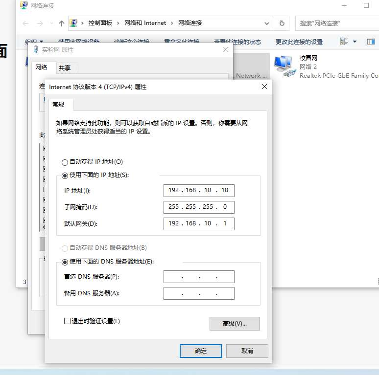
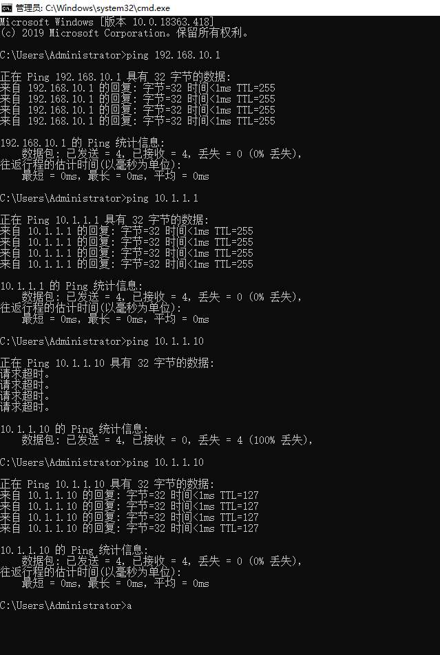
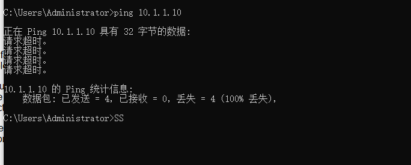

# 实验 2：访问控制列表实验心得体会

| 项目 | 内容 |
| :--- | :--- |
| 院系 | 计算机学院 |
| 班级 | 4班 |
| 学号 | 24325144 |
| 实验名称 | 访问控制列表实验（ACL） |
| 学生 | 李伟龙 |

## 一、本人承担的工作

本实验中我主要负责**员工机**这一侧的工作，具体包括：

1. **配置员工机的网络参数**：为员工机的实验网网卡配置 IP 地址 `192.168.10.10`、子网掩码 `255.255.255.0`、默认网关 `192.168.10.1`。
2. **连通性验证**：在员工机上执行分层 `ping`、`arp -a` 等命令，验证员工机与路由器、服务器之间的网络连通性。
3. **网页访问验证**：用浏览器访问 `http://10.1.1.10`，确认在未配置 ACL 时能够正常访问服务器上的 Web 服务。
4. **ACL 生效验证**：配合负责路由器配置的同学，在应用 ACL 之后再次在员工机上验证访问是否被拦截。

## 二、实验过程与实施细节

### 1. 配置员工机 IP 地址与默认网关

在员工机的「实验网」网卡上，打开 IPv4 属性，配置 IP 地址 `192.168.10.10`、子网掩码 `255.255.255.0`、默认网关 `192.168.10.1`。



这一步让我意识到，PC 的默认网关其实就是**路由器在本网段接口上的 IP 地址**——员工机要跨网段访问服务器，就是把数据包先交给这个网关。

### 2. 分层验证连通性

配置完成后，在员工机 CMD 中分层执行 ping，从近到远逐段确认链路：

```cmd
ping 192.168.10.1      :: 员工机 → 路由器本地接口
ping 10.1.1.1          :: 跨过路由器到对端接口
ping 10.1.1.10         :: 全程到服务器
arp -a
```



### 3. 网页访问验证

在浏览器地址栏输入 `http://10.1.1.10`，成功打开 Apache 的默认页面，说明员工机到服务器的网络链路与 Web 服务均正常。

### 4. 应用 ACL 后验证拦截效果

路由器上应用 ACL 2000 后，我再次在员工机上 `ping 10.1.1.10`，结果变为**不通**（100% 丢失）——证明基本 ACL 按源 IP 拦截了来自员工机的所有报文（包括 ICMP）。



## 三、我自己遇到的困难及解决方法

**困难 1：不理解路由器端口 IP 命令里 `*.*.*.*` 该填什么**

一开始看操作手册步骤 2 中的 `[R-Ethernet0/0/2] ip address *.*.*.* 24`，我不知道这个 `*.*.*.*` 到底该填什么 IP，一开始误以为是 `172.16.6` 网段。

后来结合AI才理解这里要填的就是手册里已经给出的端口 IP——员工机这一侧填 `192.168.10.1`，服务器那一侧填 `10.1.1.1`。也就是说，**路由器每个端口的 IP 就是它所在网段的网关地址**，而不是随便填一个网段。

**困难 2：实验室 PC 有两块网卡，分不清该配哪一块**

实验室的 PC 同时有两块网卡：一块连接校园网，另一块连接实验网。最开始我 ping 不通时，就是因为没搞清楚数据是从哪块网卡出去的——如果走的是校园网网卡，`ping 192.168.10.1` 自然不通。

后来我通过 `ipconfig` 和 `arp -a` 逐步排查，明确实验网网卡才是需要配置的那块，其 IP、掩码、网关都按 `192.168.10.x` 这个网段来设置。**搞清楚两块网卡各自的作用，是本次实验能跑通的前提。**

**困难 3：误以为手册的 IP 是固定的**

最初我以为 `192.168.10.*` 和 `10.1.1.*` 是实验规定的、不能改的地址。后来才意识到，这两个网段只是示例，只要保证同一网段内的 IP 不冲突、掩码和网关设置正确，**完全可以替换成其他局域网 IP**。理解这一点后，我对「IP 规划」有了更直观的认识。

**困难 4：误以为 ACL 实验第一步就是配 ACL 规则**

一开始我以为做 ACL 实验就是直接去路由器上写 `acl` 规则。实际动手后才发现，第一步其实是**先搭好拓扑、配好主机和路由器端口、确认连通性**，然后才是配置 ACL。基础连通性都不通的话，ACL 的效果根本无法验证。

## 四、体会与总结

通过本次实验，我有几点比较深的体会：

1. **对「网关」的理解更具体了**。以前网关只是一个需要填写的字段，这次实验让我明白：PC 的默认网关就是路由器在本网段接口上的 IP，PC 要跨网段通信时，就是把数据包先交给这个网关。

2. **学会分层排查网络故障**。ping 不通时不要乱猜，而是从近到远一层层 ping（网关 → 对端路由器接口 → 目标主机），配合 `ipconfig`、`arp -a` 就能快速定位问题出在哪一段。多网卡导致流量走错网卡的问题，就是靠这种分层排查发现的。

3. **理解了基本 ACL 的作用和局限**。基本 ACL 只按源 IP 匹配，所以应用后员工机连 `ping` 都被一起拦掉了，这让我对「按源地址做粗粒度控制」和「按协议端口做细粒度控制」的区别有了切身体会。

4. **团队协作与分工**。本次实验由组内同学分别负责员工机、服务器、路由器配置，最后合在一起验证。每个人的部分都直接影响整体结果，任何一个环节（比如某块网卡没配好）都会让整条链路不通，这让我更体会到网络实验里「全局观」的重要性。

