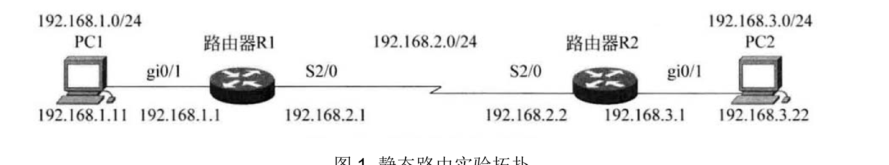
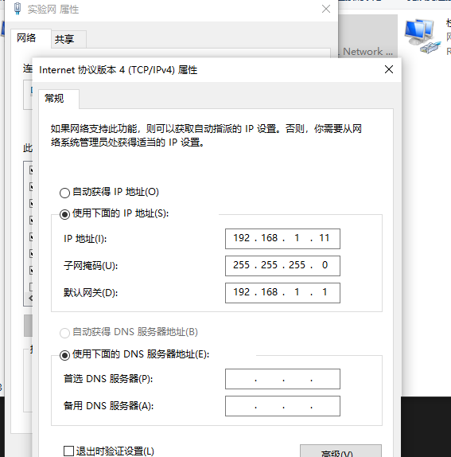
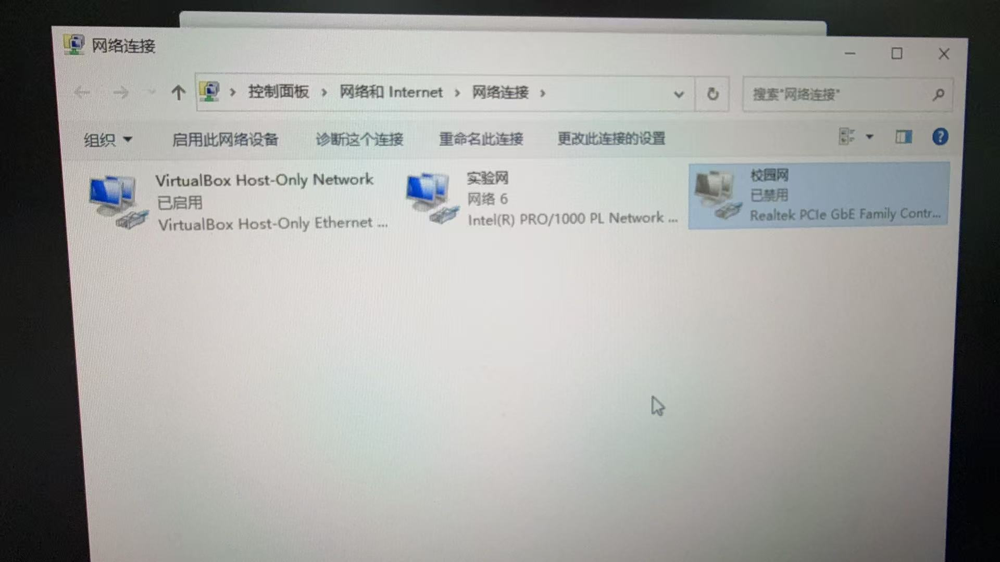
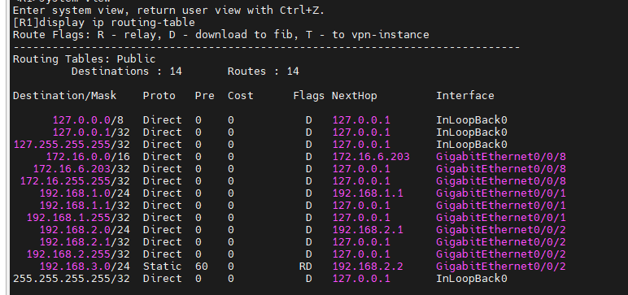
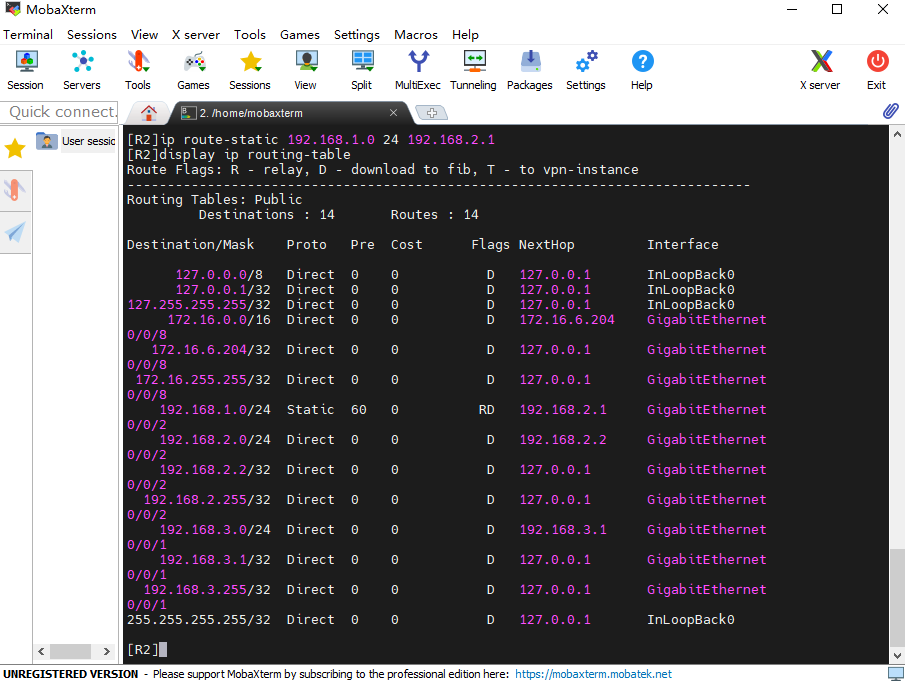
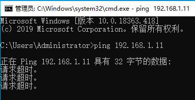
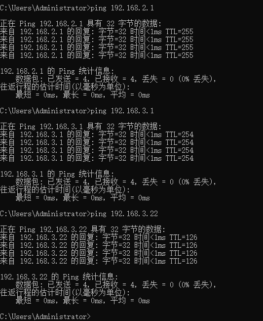
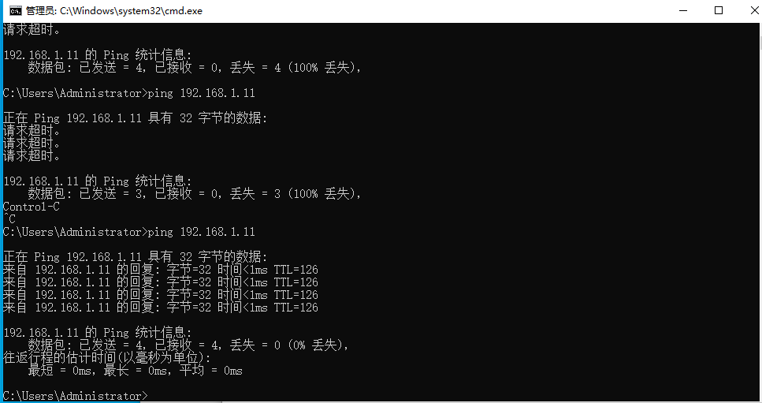

# 实验 3：静态路由实验报告

## 小组信息

**第六组**

| 角色 | 姓名 | 学号 | 自评分 |
| :--- | :--- | :--- | :--- |
| 组长 | 闫维岳 | 24325288 | 90 |
| 组员 | 苏文韬 | 24325237 | 90 |
| 组员 | 薛淞 | 24325286 | 90 |
| 组员 | 李伟龙 | 24325144 | 90 |

## 一、实验目的

- 掌握路由器接口 IP 地址与静态路由的配置方法。
- 理解路由器依据路由表逐跳转发报文的过程，以及去程、回程路由的双向性。
- 学会用 `display ip routing-table`、`ping`、`tracert` 验证路由是否生效。

## 二、实验拓扑与设备



| 设备 | 接口 | IP 地址 | 连接对象 |
| :--- | :--- | :--- | :--- |
| PC1 | 实验网卡 | `192.168.1.11/24`，网关 `192.168.1.1` | R1 GE0/0/1 |
| R1 | GE0/0/1 / GE0/0/2 | `192.168.1.1/24` / `192.168.2.1/24` | PC1 / R2 |
| R2 | GE0/0/1 / GE0/0/2 | `192.168.3.1/24` / `192.168.2.2/24` | PC2 / R1 |
| PC2 | 实验网卡 | `192.168.3.22/24`，网关 `192.168.3.1` | R2 GE0/0/1 |

## 三、小组成员分工

| 姓名 | 承担任务 |
| :--- | :--- |
| 闫维岳 | PC2、R2配置、整理截图 |
| 苏文韬 | PC2、R2配置、撰写实验报告 |
| 薛淞 | PC1、R1配置、整理截图 |
| 李伟龙 | PC1、R1配置、问题排查 |

## 四、实验步骤

### 4.1 配置 PC

PC1：`192.168.1.11 / 255.255.255.0`，网关 `192.168.1.1`；PC2：`192.168.3.22 / 255.255.255.0`，网关 `192.168.3.1`。



PC 同时有校园网网卡（`172.16.6.x`）和实验网网卡。一开始我们忘记禁用校园网网卡，导致无法ping通过，禁用后才解决。




### 4.2 配置路由器接口

```
[R1] interface GigabitEthernet0/0/1
[R1-GigabitEthernet0/0/1] ip address 192.168.1.1 24
[R1-GigabitEthernet0/0/1] undo shutdown
[R1-GigabitEthernet0/0/1] quit
[R1] interface GigabitEthernet0/0/2
[R1-GigabitEthernet0/0/2] ip address 192.168.2.1 24
[R1-GigabitEthernet0/0/2] undo shutdown

[R2] interface GigabitEthernet0/0/1
[R2-GigabitEthernet0/0/1] ip address 192.168.3.1 24
[R2-GigabitEthernet0/0/1] undo shutdown
[R2-GigabitEthernet0/0/1] quit
[R2] interface GigabitEthernet0/0/2
[R2-GigabitEthernet0/0/2] ip address 192.168.2.2 24
[R2-GigabitEthernet0/0/2] undo shutdown
```

### 4.3 配置静态路由

```
[R1] ip route-static 192.168.3.0 24 192.168.2.2
[R2] ip route-static 192.168.1.0 24 192.168.2.1
```

R1 把去往 PC2 网段的报文交给 `192.168.2.2`，R2 把去往 PC1 网段的报文交给 `192.168.2.1`，构成去程与回程。

### 4.4 验证

两台路由器的路由表中均出现预期条目：R1 的 `192.168.3.0/24`、R2 的 `192.168.1.0/24` 为 `Static`，优先级 `Pre=60`，下一跳分别为 `192.168.2.2`、`192.168.2.1`。





配置前 PC2 ping PC1 全部超时，与预期一致：



配置后在 PC1 上测试，三条 ping 均 4 发 4 收、丢包率 0%：



| 目标 | TTL | 说明 |
| :--- | :--- | :--- |
| `192.168.2.1` | 255 | R1 本机接口直接应答 |
| `192.168.3.1` | 254 | 经 R1 一跳，R2 应答 |
| `192.168.3.22` | 126 | PC2 初始 TTL 为 128，经 R1、R2 两跳 |

反向验证：PC2 ping PC1（`192.168.1.11`）成功，TTL=126。



## 五、实验结果

| 验证项 | 配置前 | 配置后 |
| :--- | :--- | :--- |
| PC1 → PC2（`192.168.3.22`） | 不通 | 通，TTL=126 |
| PC2 → PC1（`192.168.1.11`） | 不通 | 通，TTL=126 |
| R1、R2 静态路由条目 | 无 | 已加载（Pre=60） |

配置两条方向相反的静态路由后，PC1 与 PC2 双向互通，实验成功。

## 六、遇到的问题与解决方法

| 问题 | 原因 | 解决方法 |
| :--- | :--- | :--- |
| 按手册 `Ethernet0/0/1` 配置时报错 | 设备实际接口为 `GigabitEthernet0/0/x` | 先 `display ip interface brief` 确认真实接口名 |
| PC1 ping `192.168.2.1` 超时，`tracert` 第一跳为 `172.16.0.1` | 双网卡存在两个默认网关，Windows 选择了校园网网卡 | 禁用校园网网卡；也可用 `route add` 添加精确路由 |
| 禁用校园网网卡后无法 telnet | 管理流量走校园网网卡 | 先完成路由器配置，最后再禁用网卡测试 |
| 配置前 PC1、PC2 不通 | 两台路由器都缺少对端网段的路由 | 正常现象；双向配置静态路由后恢复 |

## 七、实验思考

### （1）配置静态路由前，PC1 ping PC2 为何不通？

PC1 把去往 `192.168.3.22` 的报文交给默认网关 R1，但 R1 路由表中只有 `192.168.1.0/24`、`192.168.2.0/24` 直连路由，没有 `192.168.3.0/24`，报文被丢弃。即使去程可达，R2 也没有回程路由 `192.168.1.0/24`，应答同样无法返回。因此静态路由必须双向配置。

### （2）共配置了几条静态路由？分别是什么？含义是什么？

共 2 条，分别负责去程和回程：

- R1：`ip route-static 192.168.3.0 24 192.168.2.2`，去往 PC2 网段 `192.168.3.0/24` 的报文下一跳交给 R2 的 `192.168.2.2`；
- R2：`ip route-static 192.168.1.0 24 192.168.2.1`，去往 PC1 网段 `192.168.1.0/24` 的报文下一跳交给 R1 的 `192.168.2.1`。

命令格式为 `ip route-static <目的网段> <掩码长度> <下一跳地址>`。

### （3）存在多条去往同一网段的路由时，路由器如何选择？

最长前缀匹配优先、优先级（Preference）小者优先、开销小者优先、等价路由负载分担


## 八、完成情况

完成两台 PC 的 IP、掩码、网关配置，并处理了双网卡默认网关冲突；完成 R1、R2 接口 IP 与两条静态路由配置，路由表条目正确；PC1 与 PC2 双向 ping 通，TTL 符合两跳转发。
