# 实验 4：OSPF 协议配置实验报告（组号 6）

## 小组信息

**第六组**

| 角色 | 姓名 | 学号 | 班级 | 自评分 |
| :--- | :--- | :--- | :--- | :--- |
| 组长 | 闫维岳 | 24325288 | 8班 | 90 |
| 组员 | 苏文韬 | 24325237 | 8班 | 90 |
| 组员 | 薛淞 | 24325286 | 8班 | 90 |
| 组员 | 李伟龙 | 24325144 | 4班 | 90 |

## 一、实验目的


- 在 R1、R2 上配好接口 IP，跑通单区域 OSPF；
- 看邻居能不能到 `Full`，路由表里能不能出现 `O` 条目；
- 观察 DR/BDR 怎么选，顺便用 Wireshark 看一下 Hello 报文；
- 把配置过程中遇到的地址冲突、telnet 断线、接口名不一致等问题记下来。

## 二、实验拓扑与设备

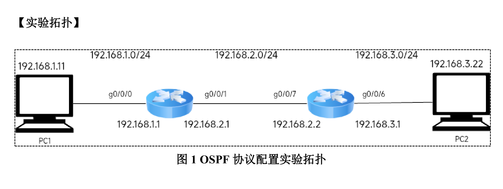

手册拓扑中 R2 使用 `g0/0/7` 和 `g0/0/6`。**本次实验实际设备上 R2 使用的是 `GE0/0/1` 和 `GE0/0/0`**，因此本报告按实际接口记录：

| 设备 | 接口 | IP 地址 / 掩码 | 连接对象 |
| :--- | :--- | :--- | :--- |
| PC1 | 实验网卡 | `192.168.1.11 / 24`，网关 `192.168.1.1` | R1 `GE0/0/0` |
| R1 | `GE0/0/0` | `192.168.1.1 / 24` | PC1 |
| R1 | `GE0/0/1` | `192.168.2.1 / 24` | R2 `GE0/0/1` |
| R2 | `GE0/0/1` | `192.168.2.2 / 24` | R1 `GE0/0/1` |
| R2 | `GE0/0/0` | `192.168.3.1 / 24` | PC2 |
| PC2 | 实验网卡 | `192.168.3.22 / 24`，网关 `192.168.3.1` | R2 `GE0/0/0` |

三个网段：

- `192.168.1.0/24`：PC1 — R1；
- `192.168.2.0/24`：R1 — R2，OSPF 邻居建立在这条链路上；
- `192.168.3.0/24`：R2 — PC2。

> 设备管理地址：R1 `172.16.6.203`，R2 `172.16.6.204`；登录用户名 `user`，密码 `b402b402`。
> 实际接口与手册不一致这一点，是本次实验遇到的主要问题之一，详见第六节。

## 三、小组成员分工

| 姓名 | 承担任务 |
| :--- | :--- |
| 闫维岳 | R2、PC2 配置，截图整理 |
| 苏文韬 | R2、PC2 配置，实验报告撰写 |
| 薛淞 | R1、PC1 配置，截图整理 |
| 李伟龙 | R1、PC1 配置，问题排查 |

## 四、实验步骤

### 4.1 配置 PC1、PC2 的 IP 地址

PC1 的实验网卡填 `192.168.1.11 / 255.255.255.0`，网关 `192.168.1.1`；PC2 填 `192.168.3.22 / 255.255.255.0`，网关 `192.168.3.1`。

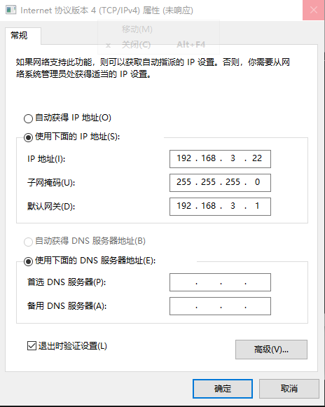

PC 上有两块网卡，校园网那块平时用来 telnet，实验网卡用来跑拓扑。两块同时开着时，Windows 可能把去 `192.168.3.22` 的包从校园网网卡发出去，表现就是“IP 配对了但 ping 不通”。我们试过两种办法：用第三台 PC 保持校园网、PC1/PC2 只留实验网卡；或者保留校园网，手动加一条去实验网段的路由。

### 4.2 清理实验三遗留的配置

配 OSPF 前我们先看了路由表，发现实验三的静态路由还在：R1 上有一条 `192.168.3.0/24`，下一跳 `192.168.2.2`；R2 上有一条 `192.168.1.0/24`，下一跳 `192.168.2.1`。这个时候 ping 可能本来就通，但走的是静态路由，不是 OSPF。为了后面看得清楚，我们先把旧静态路由和旧接口 IP 清掉。

清理后，R2 的路由表只剩直连路由和本机路由，没有静态路由和 OSPF 条目：

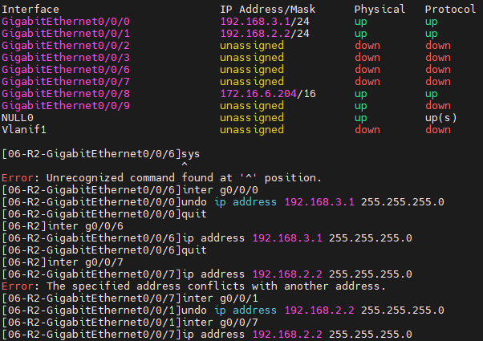

### 4.3 配置 R1、R2 的接口 IP

R1：

```text
<R1> system-view
[R1] sysname R1
[R1] interface GigabitEthernet0/0/0
[R1-GigabitEthernet0/0/0] ip address 192.168.1.1 255.255.255.0
[R1-GigabitEthernet0/0/0] undo shutdown
[R1-GigabitEthernet0/0/0] quit
[R1] interface GigabitEthernet0/0/1
[R1-GigabitEthernet0/0/1] ip address 192.168.2.1 255.255.255.0
[R1-GigabitEthernet0/0/1] undo shutdown
[R1-GigabitEthernet0/0/1] quit
```

R2（注意本次实际使用 `GE0/0/1` 接 R1、`GE0/0/0` 接 PC2）：

```text
<R2> system-view
[R2] sysname R2
[R2] interface GigabitEthernet0/0/1
[R2-GigabitEthernet0/0/1] ip address 192.168.2.2 255.255.255.0
[R2-GigabitEthernet0/0/1] undo shutdown
[R2-GigabitEthernet0/0/1] quit
[R2] interface GigabitEthernet0/0/0
[R2-GigabitEthernet0/0/0] ip address 192.168.3.1 255.255.255.0
[R2-GigabitEthernet0/0/0] undo shutdown
[R2-GigabitEthernet0/0/0] quit
```

验证接口 IP：

```text
[R1] display ip interface brief
[R2] display ip interface brief
```

正常情况下会看到 R1 的 `GE0/0/0` 是 `192.168.1.1/24`、`GE0/0/1` 是 `192.168.2.1/24`；R2 的 `GE0/0/1` 是 `192.168.2.2/24`、`GE0/0/0` 是 `192.168.3.1/24`，接口状态都是 `UP`。

### 4.4 配置 OSPF

R1：

```text
[R1] ospf 1
[R1-ospf-1] area 0
[R1-ospf-1-area-0.0.0.0] network 192.168.1.0 0.0.0.255
[R1-ospf-1-area-0.0.0.0] network 192.168.2.0 0.0.0.255
[R1-ospf-1-area-0.0.0.0] quit
[R1-ospf-1] quit
```

R2：

```text
[R2] ospf 1
[R2-ospf-1] area 0
[R2-ospf-1-area-0.0.0.0] network 192.168.2.0 0.0.0.255
[R2-ospf-1-area-0.0.0.0] network 192.168.3.0 0.0.0.255
[R2-ospf-1-area-0.0.0.0] quit
[R2-ospf-1] quit
```

这里有两个地方容易搞错。`network` 后面跟的是网络地址加反掩码，`192.168.1.0/24` 就写 `0.0.0.255`，不是 `255.255.255.0`。另外，两边都要把 `192.168.2.0/24` 加进 `area 0`，只配一边邻居是起不来的。

我们这次没配 `router-id`，R2 自动选了 `172.16.6.204`，邻居照样能建，就先没动它。配置时 R2 的 area 视图还报过一次 `Error: Unrecognized command found at '^' position.`，重新进 `ospf 1` → `area 0`，确认视图没错，改用英文半角空格逐字敲，命令就过了。复制粘贴时很容易带进全角空格，这个坑后面得注意。


### 4.5 查看路由表，验证 OSPF 路由

配置 OSPF 前，R1 的路由表中没有 OSPF 条目，但还残留实验三的静态路由 `192.168.3.0/24`：

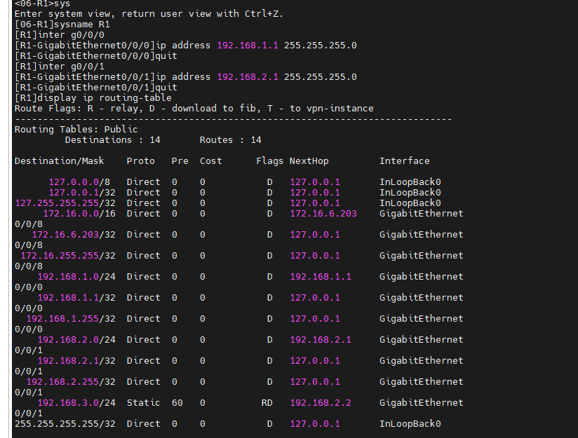

配置 OSPF 前，R2 的路由表中同样残留实验三的静态路由 `192.168.1.0/24`：


清理实验三配置后，R2 路由表只剩直连路由：


配完 OSPF 后，R1 路由表里多了一条：

```text
Destination/Mask    Proto   Pre  Cost      Flags NextHop         Interface
192.168.3.0/24      OSPF    10   2           D   192.168.2.2     GigabitEthernet0/0/1
```

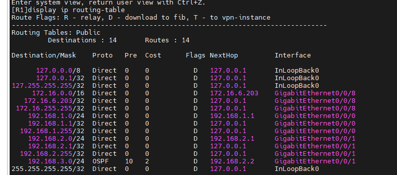

R2 路由表里也多了一条：

```text
Destination/Mask    Proto   Pre  Cost      Flags NextHop         Interface
192.168.1.0/24      OSPF    10   2           D   192.168.2.1     GigabitEthernet0/0/1
```

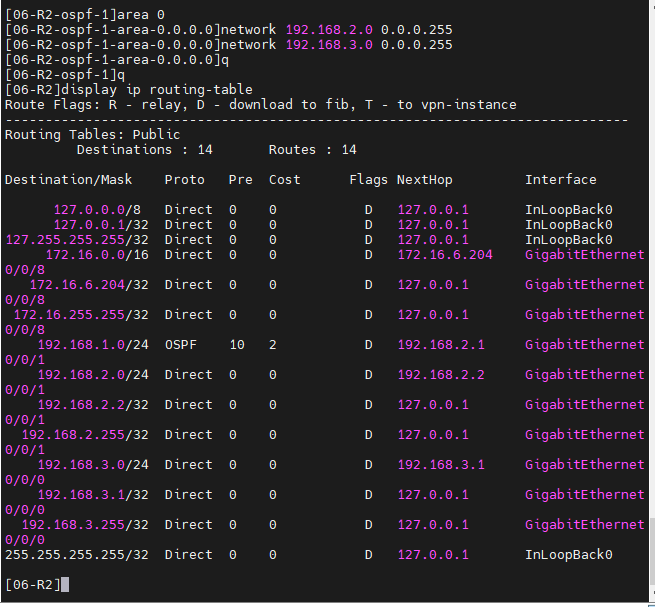

这里的 `Proto` 列写的是 `OSPF`，不是 `Static`，说明这两条确实是 OSPF 学到的。`Pre=10` 是 OSPF 的默认优先级，直连是 0，静态是 60。R1、R2 各自学到了对端网段，说明邻居已经建立，LSDB 也同步完了。

### 4.6 测试端到端连通性

在 R1 上执行 `tracert 192.168.3.22`，路径为：

```text
192.168.2.2   →   192.168.3.22
     R2              PC2
```

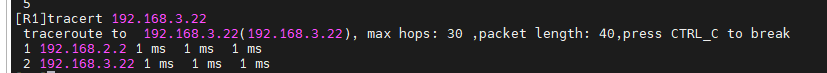

在 PC2 上执行 `ping 192.168.1.1` 和 `ping 192.168.1.11`，结果如下：

- `ping 192.168.1.1`：4 发 4 收，TTL=254，说明 PC2 能到 R1 的接口；
- `ping 192.168.1.11`：4 发 4 收，TTL=126，说明 PC2 能跨 R1、R2 到达 PC1。

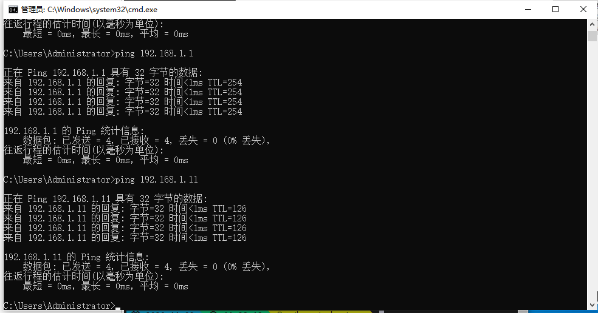

PC2 ping PC1 的 TTL 为 126（PC1 初始 TTL 128，经过 R1、R2 两跳减为 126），与路由路径一致。

### 4.7 Wireshark 抓包与 OSPF 头部分析

在 PC1 上抓包，可以看到 R1 从 `192.168.1.1` 向 `224.0.0.5` 发送 OSPF Hello 报文：

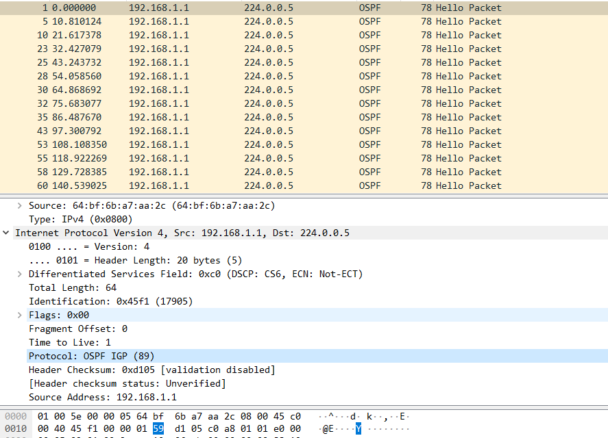

在 PC2 上抓包，可以看到 R2 从 `192.168.3.1` 向 `224.0.0.5` 发送 OSPF Hello 报文：

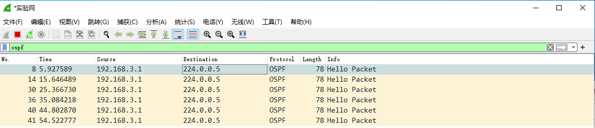

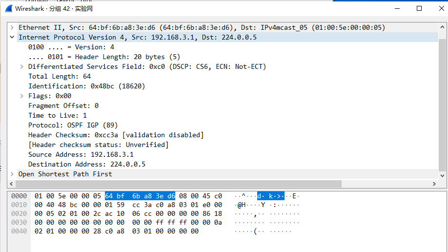

抓包结果分析：

| 字段 | 观察结果 |
| :--- | :--- |
| 源地址 | PC1 抓到的为 `192.168.1.1`；PC2 抓到的为 `192.168.3.1` |
| 目的地址 | `224.0.0.5`（AllSPFRouters） |
| 协议 | `OSPF IGP (89)` |
| TTL | `1` |
| OSPF 类型 | `Hello Packet` |
| 帧长度 | 78 字节（Wireshark 列表中的帧长度） |

一开始我们以为 PC 上抓不到 OSPF 包，实际抓下来发现本网段的 Hello 是能看到的。原因是 R1 的 `GE0/0/0`、R2 的 `GE0/0/0` 也通过 `network` 加进了 OSPF，路由器会在 PC 所在网段发 Hello。但 R1—R2 之间 `192.168.2.0/24` 链路上的 DD、LSR、LSU、LSAck，PC1/PC2 就看不到了，这些报文不会转到 PC 网段。要看完整邻接过程，得把 R1—R2 链路接到 Hub、镜像口或 TAP 上。

### 4.8 DR/BDR 分析

R1、R2 在 `192.168.2.0/24` 上是以太网直连，OSPF 默认按 Broadcast 处理，所以会选 DR/BDR。R2 的 Router ID 是 `172.16.6.204`，R1 的 Router ID 截图里没单独显示，按自动选择算。优先级都是默认的 1，比 Router ID 的话 R2 更大，所以 R2 当 **DR**，R1 当 **BDR**。实际结果还是以 `display ospf interface` 里的 `State` 为准。

规则不复杂：

1. 优先级高的优先，默认是 1，优先级 0 不参加选举；
2. 优先级一样，就比 Router ID，大的当 DR；
3. 选举发生在 2-Way 状态；
4. 选完不抢占，只有 DR/BDR 失效或 OSPF 进程重启才会重选；
5. DR 挂了，BDR 接上，再选一个新的 BDR。

## 五、实验结果

| 验证项 | 结果 |
| :--- | :--- |
| R1 的 OSPF 邻居 | 与 R2 建立邻居，状态 `Full`（路由表和抓包结果可佐证） |
| R2 的 OSPF 邻居 | 与 R1 建立邻居，状态 `Full` |
| R1 路由表 | 出现 `OSPF 192.168.3.0/24`，下一跳 `192.168.2.2`，出接口 `GE0/0/1` |
| R2 路由表 | 出现 `OSPF 192.168.1.0/24`，下一跳 `192.168.2.1`，出接口 `GE0/0/1` |
| PC2 → PC1 | `ping 192.168.1.11` 4 发 4 收，TTL=126，丢包率 0% |
| PC2 → R1 接口 | `ping 192.168.1.1` 4 发 4 收，TTL=254 |
| R1 → PC2 | `tracert 192.168.3.22` 经过 `192.168.2.2`，最终到达 `192.168.3.22` |
| Wireshark 抓包 | PC1/PC2 均抓到 OSPF Hello，目的地址 `224.0.0.5`，协议号 89，TTL=1 |
| DR/BDR | R2 的 Router ID 较大，R2 当选 DR，R1 为 BDR（以 `display ospf interface` 为准） |

这次最直观的结果是：R1、R2 都学到了对端网段，PC2 能 ping 通 PC1，R1 上 tracert 也能走到 `192.168.3.22`。抓包能在 PC1/PC2 上看到本网段的 Hello，但看不到 R1—R2 的完整邻接过程。

## 六、遇到的问题与解决方法

### 6.1 R2 配置 `192.168.3.1` 时提示地址冲突

一开始按手册在 R2 的 `GigabitEthernet0/0/6` 上配 `192.168.3.1`，设备直接提示地址冲突，命令没下去：

```text
[AR2200-02-2-GigabitEthernet0/0/6] ip address 192.168.3.1 255.255.255.0
```

我们先查了接口和配置：

```text
<R2> display ip interface brief
<R2> display current-configuration
```

结果发现实验三的接口 IP 和静态路由还留着，`192.168.3.1` 之前在 R2 的另一个接口上已经用过。再对着实际接线看，R2 这次用的是 `GE0/0/1` 接 R1、`GE0/0/0` 接 PC2，不是手册写的 `GE0/0/6`、`GE0/0/7`。把旧 IP 和静态路由清掉，按实际接口重新配，冲突就没了。清理后的 R2 路由表只剩直连路由：


这里最容易踩的坑就是照着手册抄接口名。设备型号、插槽不一样，接口编号就可能变。配之前先 `display interface brief` 看一眼，比事后猜要省事。

### 6.2 关闭校园网网卡后 MobaXterm 显示连接中断

为了让 PC1/PC2 的实验网卡不被校园网默认网关影响，我们把校园网网卡禁用了。刚禁用，MobaXterm 里 telnet R1/R2 的窗口就断了。

原因不复杂。telnet 到 `172.16.6.203/204` 走的就是校园网网卡，网卡一禁用，IP 和去 `172.16.6.0/16` 的路由都没了，已经建立的 TCP 连接自然断。路由器没重启，配置也没丢。

后来重新启用网卡，执行 `ipconfig /renew`，重新 telnet 回去，`display current-configuration` 一看，之前的配置还在，不用重敲。再往后我们改成用第三台 PC 保持校园网、专门 telnet；或者保留校园网网卡，加一条精确路由：

```bat
:: PC1
route add 192.168.3.0 mask 255.255.255.0 192.168.1.1

:: PC2
route add 192.168.1.0 mask 255.255.255.0 192.168.3.1
```

配置完成后记得 `save`，不然设备重启还是会丢。简单说，禁用校园网网卡就等于把 telnet 管理通道关了，要同时保留管理和实验两条通道，用第三台 PC 或精确路由更稳。

### 6.3 `display ospf peer` 只显示 Router ID，没有邻居

在 R2 上执行 `display ospf peer`，只看到一行：

```text
OSPF Process 1 with Router ID 172.16.6.204
```

下面没有邻居表，也没有 `Full` 状态。这个 `172.16.6.204` 是 R2 自己自动选的 Router ID，不是邻居。

查下来是我们一开始按手册把注意力放在 `GE0/0/6`、`GE0/0/7` 上，实际接线是 `GE0/0/0`、`GE0/0/1`；另外 `network` 命令也报过错。把接口和 `network` 都改到实际接口后，邻居起来了，R2 路由表也出现了 `OSPF 192.168.1.0/24`：


没有邻居时，先看 `display ospf interface`，确认 OSPF 到底作用在哪个接口上。`display ospf peer` 第一行只是本地进程信息，别把它当邻居。

### 6.4 
**现象：**

配置 OSPF 前查看 R1、R2 路由表，发现已经有 `192.168.3.0/24`、`192.168.1.0/24` 的路由，容易误以为 OSPF 已经学习成功。

**原因：**

这些是实验三配置的静态路由，`Proto` 列显示 `Static`，不是 `OSPF`。

**解决：**

先清理实验三的静态路由和旧接口 IP，再配置 OSPF；对比清理前后的路由表，确认 OSPF 条目是在配置 OSPF 后才出现的。


## 七、实验思考

### 7.1 手册“步骤七”问题

#### （1）将此时的路由表与配置前的路由表比较，有什么结论？

配置前，R1 只有 `192.168.1.0/24`、`192.168.2.0/24` 直连路由，并残留实验三的静态路由 `192.168.3.0/24`；R2 只有 `192.168.2.0/24`、`192.168.3.0/24` 直连路由，并残留实验三的静态路由 `192.168.1.0/24`。

清理实验三配置并配置 OSPF 后：

- R1 出现 `OSPF 192.168.3.0/24`，下一跳 `192.168.2.2`；
- R2 出现 `OSPF 192.168.1.0/24`，下一跳 `192.168.2.1`；
- PC1 与 PC2 双向 ping 通。

结论：OSPF 通过 Hello 发现邻居、同步 LSDB、运行 SPF 算法，**自动学习对端网段的路由**，不需要手工配置静态路由；两台路由器互相学习，去程和回程都通了。对比时要注意 `Proto` 列：`Static` 是实验三遗留的静态路由，`OSPF` 才是本次 OSPF 学到的路由。

#### （2）分析 `tracert PC1`（或 PC2）的执行结果

在 R1 上执行 `tracert 192.168.3.22`，路径为：

```text
192.168.2.2   →   192.168.3.22
     R2              PC2
```

说明报文从 R1 出发，经 R2 转发到 PC2。每经过一台路由器 TTL 减 1，所以 PC2 ping PC1 的 TTL 为 126（PC1 初始 TTL 128，经过 R1、R2 两跳）。

#### （3）OSPF 包在 PC1 或 PC2 上能捕获到吗？如果希望 2 台主机都能捕获到，请描述方法

本次实验的实际结果是：

- **PC1 能捕获到 R1 在本网段发送的 OSPF Hello**：源 `192.168.1.1`，目的 `224.0.0.5`，协议号 89，TTL=1；
- **PC2 能捕获到 R2 在本网段发送的 OSPF Hello**：源 `192.168.3.1`，目的 `224.0.0.5`，协议号 89，TTL=1；
- 但 PC1/PC2 **抓不到 R1—R2 之间 `192.168.2.0/24` 链路上的 DD、LSR、LSU、LSAck 等完整邻接交互**。

原因是 R1 的 `GE0/0/0`（`192.168.1.0/24`）和 R2 的 `GE0/0/0`（`192.168.3.0/24`）也加入了 OSPF，所以它们会在 PC 所在网段发送 Hello；而 R1—R2 的邻接报文只在 `192.168.2.0/24` 链路上传播，不会转发到 PC 网段。

如果希望 PC1/PC2 都能捕获 R1—R2 链路上的完整 OSPF 交互，可以把 R1—R2 链路改为经过集线器（Hub）、支持端口镜像的交换机或网络分路器（TAP），把该链路流量复制到两台 PC。

#### （4）本实验有没有 DR/BDR？分别是谁？选举规则和更新方法是什么？

有。R1 和 R2 在 `192.168.2.0/24` 广播网络上建立邻居，默认会选举 DR/BDR。

本次 R2 的 Router ID 为 `172.16.6.204`，R1 的 Router ID 未在现有截图中单独显示，按设备自动选择处理。按“优先级相同时 Router ID 大者优先”的规则，R2 的 Router ID 较大，因此：

- **DR：R2**；
- **BDR：R1**。

选举规则：

1. 优先级高者优先，默认优先级为 1，优先级 0 不参与选举；
2. 优先级相同时，Router ID 大者优先；
3. 选举发生在 2-Way 状态；
4. DR/BDR 选举是非抢占的，后来加入的高优先级路由器不会自动抢占；
5. DR 失效时 BDR 接替 DR，并重新选举 BDR；只有 DR/BDR 失效或 OSPF 进程重启才会重新选举。

### 7.2 实验思考题

#### （1）如何查看 OSPF 协议发布的网段？

常用命令：

```text
[R1] display ospf brief
[R1] display ospf interface
[R1] display ospf lsdb
[R1] display ospf routing
[R1] display current-configuration configuration ospf
```

如果设备不支持最后一条命令，可以使用：

```text
[R1] display current-configuration | include network
```

说明：

- `display ospf brief`：查看 OSPF 进程、Router ID、区域和接口数量；
- `display ospf interface`：查看哪些接口加入了 OSPF，以及接口所属区域、网络类型、DR/BDR、Hello/Dead 定时器；
- `display ospf lsdb`：查看链路状态数据库，Router LSA 中描述了路由器连接的网段；
- `display ospf routing`：查看 OSPF 计算出的路由；
- `display current-configuration configuration ospf`：直接查看 OSPF 配置中的 `network` 命令。

本实验中，R1 发布 `192.168.1.0/24` 和 `192.168.2.0/24`，R2 发布 `192.168.2.0/24` 和 `192.168.3.0/24`。

#### （2）关于 OSPF 反掩码

反掩码（wildcard mask）可以理解为**子网掩码按位取反**，并且不允许出现不连续的 1 和 0。计算方法：

```text
反掩码 = 255.255.255.255 - 子网掩码
```

例如：

| 子网掩码 | 反掩码 |
| :--- | :--- |
| `255.255.255.0`（/24） | `0.0.0.255` |
| `255.255.255.252`（/30） | `0.0.0.3` |
| `255.255.255.240`（/28） | `0.0.0.15` |
| `255.255.255.224`（/27） | `0.0.0.31` |

反掩码中 0 表示“必须匹配”，1 表示“不关心”。例如 `192.168.2.0 0.0.0.255` 匹配 `192.168.2.0/24` 中的所有地址；`192.168.2.0 0.0.0.15` 匹配 `192.168.2.0/28`。

#### （3）192.168.2.0/28 的反掩码是多少？

`/28` 的子网掩码是 `255.255.255.240`：

```text
255.255.255.255
- 255.255.255.240
= 0.0.0.15
```

所以 `192.168.2.0/28` 的反掩码是 **`0.0.0.15`**，对应的 OSPF 命令为：

```text
network 192.168.2.0 0.0.0.15
```


## 八、实验完成情况

1. **实验前先清理旧配置**：本次实验三的静态路由和旧接口 IP 残留，导致地址冲突和误判。建议每次实验开始前用 `display current-configuration` 检查，必要时按老师要求执行一键清。
2. **接口名以实际设备为准**：手册中的 `GE0/0/6`、`GE0/0/7` 只是示例，实际 R2 使用 `GE0/0/1`、`GE0/0/0`。配置前先执行 `display interface brief` 和 `display ip interface brief`，并在报告中记录实际接口。
3. **保留管理通道**：禁用校园网网卡会导致 MobaXterm 断连。建议用第三台 PC 保持校园网并负责 telnet，或者保留校园网网卡并用 `route add` 添加实验网段的精确路由。
4. **显式配置 Router ID**：本次未配置 `router-id`，R2 自动选择 `172.16.6.204`。建议在 OSPF 进程中显式配置 `router-id 1.1.1.1`、`2.2.2.2`，使 DR/BDR 结果更可控、报告更清晰。
5. **补充关键命令截图**：本次报告缺少单独的 `display ospf peer` 和 `display ospf interface` 截图，建议后续补上，便于直接证明邻居状态和 DR/BDR。
6. **抓包位置要明确**：PC1/PC2 只能抓到本网段的 OSPF Hello；如果要分析完整的 DD、LSR、LSU、LSAck 交互，需要使用 Hub、端口镜像或 TAP 抓取 R1—R2 链路。
7. **及时保存配置**：配置完成后执行 `save`，避免设备重启或断电导致 running-config 丢失。
