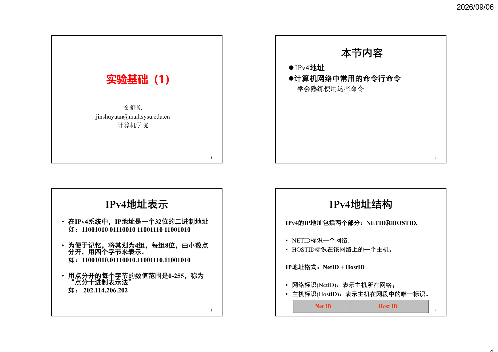
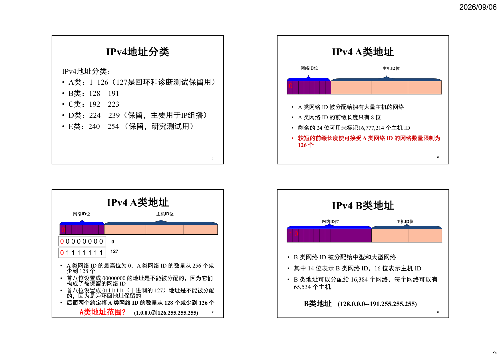
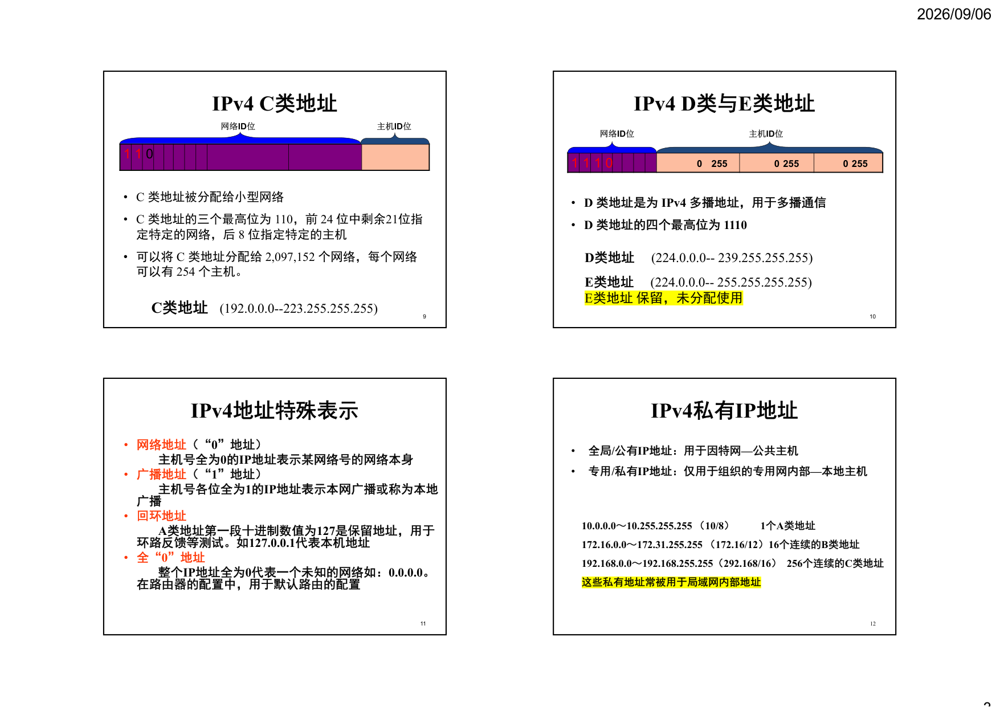
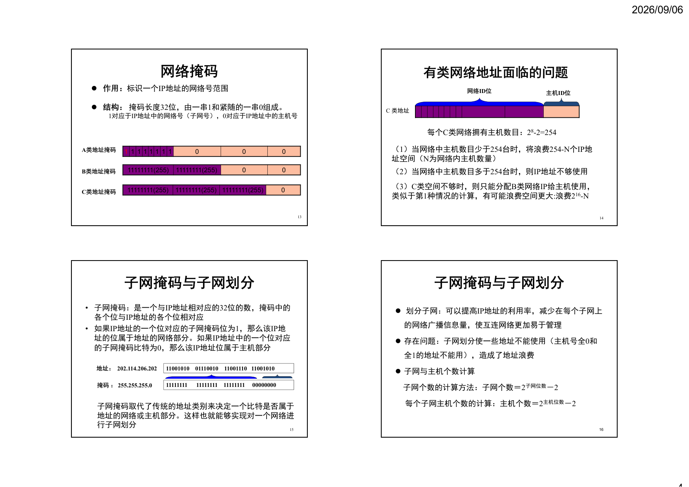
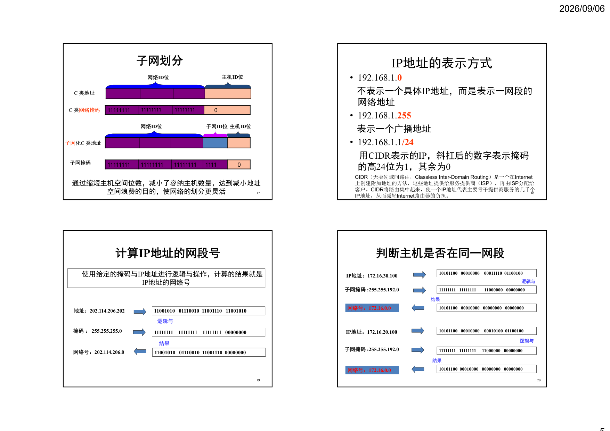
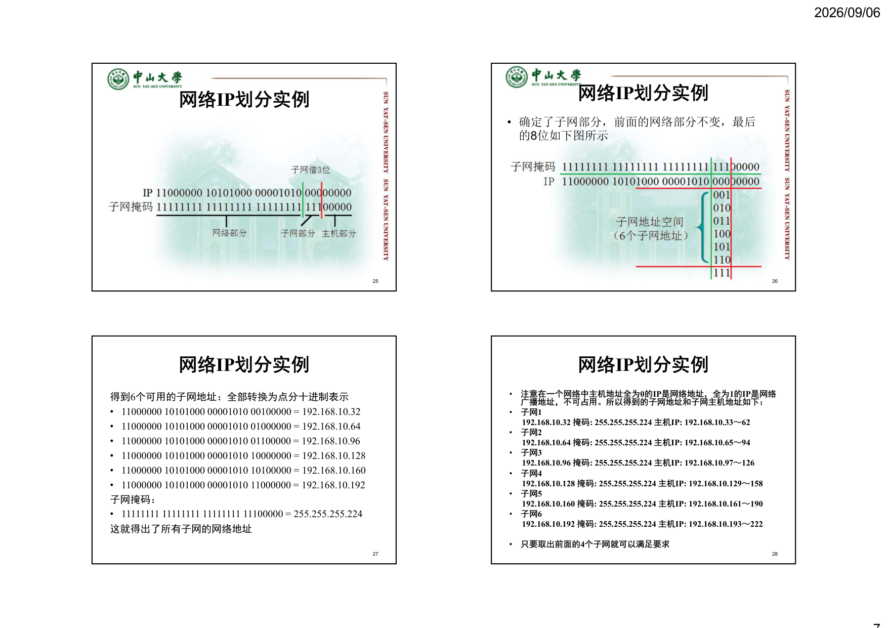
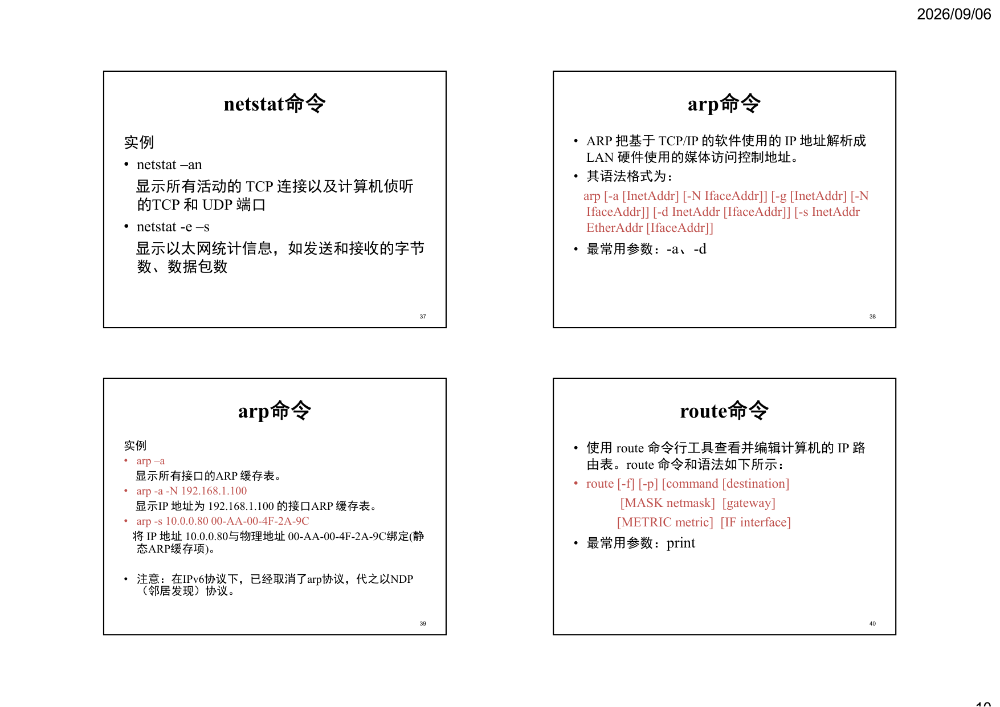
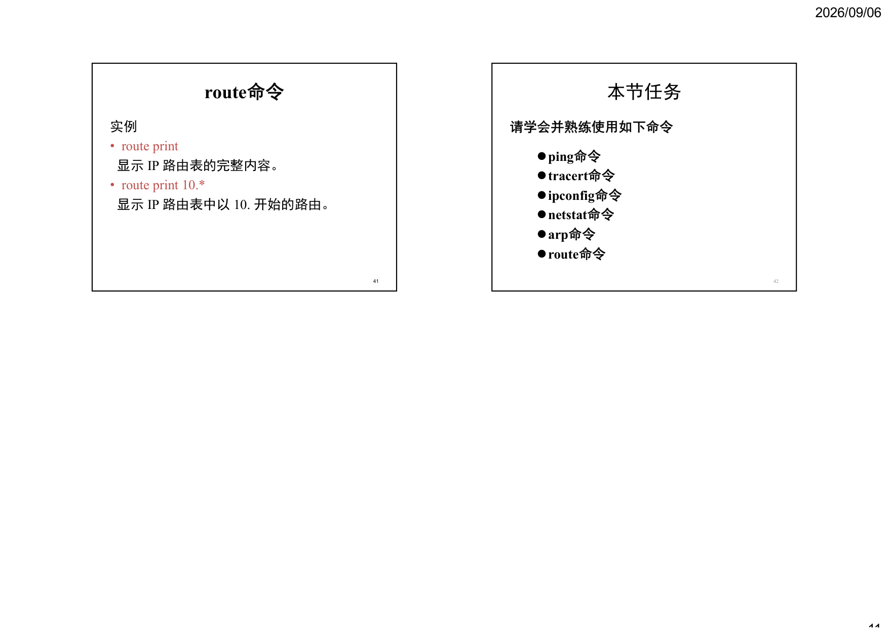

# 实验基础（1）

## 第 1 页

2026/09/06
1
1
实验基础（1）
金舒原
jinshuyuan@mail.sysu.edu.cn
计算机学院
本节内容
IPv4地址
计算机网络中常用的命令行命令
学会熟练使用这些命令
2
IPv4地址表示
• 在IPv4系统中，IP地址是一个32位的二进制地址
如：11001010 01110010 11001110 11001010
• 为便于记忆，将其划为4组，每组8位，由小数点
分开，用四个字节来表示。
如：11001010.01110010.11001110.11001010
• 用点分开的每个字节的数值范围是0-255，称为
“点分十进制表示法”
如：202.114.206.202
3
IPv4地址结构
IPv4的IP地址包括两个部分：NETID和HOSTID,
• NETID标识一个网络.
• HOSTID标识在该网络上的一个主机。
IP地址格式：NetID + HostID
• 网络标识(NetID)：表示主机所在网络；
• 主机标识(HostID)：表示主机在网段中的唯一标识。
4
Net ID
Host ID

## 第 2 页

2026/09/06
2
IPv4地址分类
IPv4地址分类：
• A类：1–126（127是回环和诊断测试保留用）
• B类：128 – 191
• C类：192 – 223
• D类：224 – 239（保留，主要用于IP组播）
• E类：240 – 254 （保留，研究测试用）
5
IPv4 A类地址
• A 类网络ID 被分配给拥有大量主机的网络
• A 类网络ID 的前缀长度只有8 位
• 剩余的24 位可用来标识16,777,214 个主机ID
• 较短的前缀长度使可接受A 类网络ID 的网络数量限制为
126 个
6
0
网络ID位
主机ID位
IPv4 A类地址
• A 类网络ID 的最高位为0，A 类网络ID 的数量从256 个减
少到128 个
• 首八位设置成00000000 的地址是不能被分配的，因为它们
构成了被保留的网络ID
• 首八位设置成01111111（十进制的127）地址是不能被分配
的，因为是为环回地址保留的
• 后面两个约定将A 类网络ID 的数量从128 个减少到126 个
7
0
0 0 0 0 0 0 0 0
0 1 1 1 1 1 1 1
0
127
网络ID位
主机ID位
A类地址范围?
(1.0.0.0到126.255.255.255)
IPv4 B类地址
• B 类网络ID 被分配给中型和大型网络
• 其中14 位表示B 类网络ID，16 位表示主机ID
• B 类地址可以分配给16,384 个网络，每个网络可以有
65,534 个主机
8
0
1
网络ID位
主机ID位
B类地址
(128.0.0.0--191.255.255.255)

## 第 3 页

2026/09/06
3
IPv4 C类地址
• C 类地址被分配给小型网络
• C 类地址的三个最高位为110，前24 位中剩余21位指
定特定的网络，后8 位指定特定的主机
• 可以将C 类地址分配给2,097,152 个网络，每个网络
可以有254 个主机。
9
0
1
1
网络ID位
主机ID位
C类地址
(192.0.0.0--223.255.255.255)
IPv4 D类与E类地址
• D 类地址是为IPv4 多播地址，用于多播通信
• D 类地址的四个最高位为1110
10
0
1
1
1
0
255
255
255
0
0
网络ID位
主机ID位
D类地址
(224.0.0.0-- 239.255.255.255)
E类地址
(224.0.0.0-- 255.255.255.255) 
E类地址 保留，未分配使用
IPv4地址特殊表示
• 网络地址（“0”地址）
主机号全为0的IP地址表示某网络号的网络本身
• 广播地址（“1”地址）
主机号各位全为1的IP地址表示本网广播或称为本地
广播
• 回环地址
A类地址第一段十进制数值为127是保留地址，用于
环路反馈等测试。如127.0.0.1代表本机地址
• 全“0”地址
整个IP地址全为0代表一个未知的网络如：0.0.0.0。
在路由器的配置中，用于默认路由的配置
11
IPv4私有IP地址
12
10.0.0.0～10.255.255.255 （10/8）
1个A类地址
172.16.0.0～172.31.255.255 （172.16/12）16个连续的B类地址
192.168.0.0～192.168.255.255（292.168/16）256个连续的C类地址
这些私有地址常被用于局域网内部地址
•
全局/公有IP地址：用于因特网—公共主机
•
专用/私有IP地址：仅用于组织的专用网内部—本地主机

## 第 4 页

2026/09/06
4
网络掩码
13
作用：标识一个IP地址的网络号范围
结构：掩码长度32位，由一串1和紧随的一串0组成。
1对应于IP地址中的网络号（子网号），0对应于IP地址中的主机号
0
0
0
1
1
1
1
1
1
1
1
A类地址掩码
0
0
11111111(255)
11111111(255)
B类地址掩码
0     
11111111(255)
11111111(255)
11111111(255)
C类地址掩码
有类网络地址面临的问题
14
网络ID位
主机ID位
C 类地址
每个C类网络拥有主机数目：28-2=254
（1）当网络中主机数目少于254台时，将浪费254-N个IP地
址空间（N为网络内主机数量）
（2）当网络中主机数目多于254台时，则IP地址不够使用
（3）C类空间不够时，则只能分配B类网络IP给主机使用，
类似于第1种情况的计算，有可能浪费空间更大:浪费216-N
子网掩码与子网划分
• 子网掩码：是一个与IP地址相对应的32位的数，掩码中的
各个位与IP地址的各个位相对应
• 如果IP地址的一个位对应的子网掩码位为1，那么该IP地
址的位属于地址的网络部分。如果IP地址中的一个位对应
的子网掩码比特为0，那么该IP地址位属于主机部分
15
11001010    01110010    11001110   11001010
11111111   11111111    11111111  00000000
掩码：255.255.255.0
地址：202.114.206.202
子网掩码取代了传统的地址类别来决定一个比特是否属于
地址的网络或主机部分。这样也就能够实现对一个网络进
行子网划分
子网掩码与子网划分
划分子网：可以提高IP地址的利用率，减少在每个子网上
的网络广播信息量，使互连网络更加易于管理
存在问题：子网划分使一些地址不能使用（主机号全0和
全1的地址不能用），造成了地址浪费
子网与主机个数计算
子网个数的计算方法：子网个数＝2子网位数－2
每个子网主机个数的计算：主机个数＝2主机位数－2
16

## 第 5 页

2026/09/06
5
子网划分
17
网络ID位
主机ID位
子网化C 类地址
子网ID位
网络ID位
主机ID位
C 类地址
0
1111
11111111
11111111
11111111
子网掩码
0
11111111
11111111
11111111
C 类网络掩码
通过缩短主机空间位数，减小了容纳主机数量，达到减小地址
空间浪费的目的，使网络的划分更灵活
IP地址的表示方式
• 192.168.1.0
不表示一个具体IP地址，而是表示一网段的
网络地址
• 192.168.1.255
表示一个广播地址
• 192.168.1.1/24
用CIDR表示的IP，斜扛后的数字表示掩码
的高24位为1，其余为0
18
CIDR（无类别域间路由，Classless Inter-Domain Routing）是一个在Internet
上创建附加地址的方法，这些地址提供给服务提供商（ISP），再由ISP分配给
客户。CIDR将路由集中起来，使一个IP地址代表主要骨干提供商服务的几千个
IP地址，从而减轻Internet路由器的负担。
计算IP地址的网段号
19
使用给定的掩码与IP地址进行逻辑与操作，计算的结果就是
IP地址的网络号
11001010   01110010  11001110   11001010
网络号：202.114.206.0
掩码：255.255.255.0
11111111    11111111    11111111   00000000
地址：202.114.206.202
11001010   01110010  11001110 00000000
逻辑与
结果
判断主机是否在同一网段
20
10101100   00010000    00011110  01100100
网络号：172.16.0.0
子网掩码:255.255.192.0
11111111   11111111  
11000000   00000000
IP地址：172.16.30.100
10101100   00010000   00000000   00000000
逻辑与
结果
10101100   00010000    00010100  01100100
网络号：172.16.0.0
子网掩码:255.255.192.0
IP地址：172.16.20.100
逻辑与
结果
11111111   11111111  11000000   00000000
10101100  00010000   00000000   00000000

## 第 6 页

2026/09/06
6
10101100   00010000    00011110  01100100
网络号：172.16.0.0
子网掩码:255.255.192.0
11111111   11111111   11000000   00000000
IP地址：172.16.30.100
10101100   00010000   00000000   00000000
逻辑与
结果
10101100   00010000    01010000  01100100
网络号：172.16.64.0
子网掩码:255.255.192.0
IP地址：172.16.80.100
逻辑与
结果
11111111   11111111  
11000000   00000000
10101100   00010000    01000000   00000000
判断主机是否在同一网段
21
网络IP划分实例
网吧新建4个机房，每个机房有25台机器，给定一个
网络地址空间：192.168.10.0，现需要将其划分为4个
子网。要求尽可能做到IP地址的最小浪费，而且要
满足现有IP地址需求。
22
网络IP划分实例
分析：192.168.10.0是一个C类的IP地址，标准掩码为
255.255.255.0，如下图所示
23
网络IP划分实例
• 要划分为4个子网必然要向最后的8位主机号借位，需考虑
借哪几位的问题
• 实际要求中有4个机房，每个房间有25台机器，也就是需
要4个子网，每个子网下面最少25台主机
• 依据子网内最大主机数来确定借几位。依公式2n-2 >= 最
大主机数，求最小n值
• 2n-2 >= 25，满足该不等式的n为5，相对应的子网需要借3
位。如下图所示
24

## 第 7 页

2026/09/06
7
网络IP划分实例
25
网络IP划分实例
26
• 确定了子网部分，前面的网络部分不变，最后
的8位如下图所示
网络IP划分实例
得到6个可用的子网地址：全部转换为点分十进制表示
• 11000000 10101000 00001010 00100000 = 192.168.10.32
• 11000000 10101000 00001010 01000000 = 192.168.10.64
• 11000000 10101000 00001010 01100000 = 192.168.10.96
• 11000000 10101000 00001010 10000000 = 192.168.10.128
• 11000000 10101000 00001010 10100000 = 192.168.10.160
• 11000000 10101000 00001010 11000000 = 192.168.10.192
子网掩码：
• 11111111 11111111 11111111 11100000 = 255.255.255.224
这就得出了所有子网的网络地址
27
网络IP划分实例
•
注意在一个网络中主机地址全为0的IP是网络地址，全为1的IP是网络
广播地址，不可占用。所以得到的子网地址和子网主机地址如下：
•
子网1
192.168.10.32 掩码: 255.255.255.224 主机IP: 192.168.10.33～62
•
子网2
192.168.10.64 掩码: 255.255.255.224 主机IP: 192.168.10.65～94
•
子网3
192.168.10.96 掩码: 255.255.255.224 主机IP: 192.168.10.97～126
•
子网4
192.168.10.128 掩码: 255.255.255.224 主机IP: 192.168.10.129～158
•
子网5
192.168.10.160 掩码: 255.255.255.224 主机IP: 192.168.10.161～190
•
子网6
192.168.10.192 掩码: 255.255.255.224 主机IP: 192.168.10.193～222
•
只要取出前面的4个子网就可以满足要求
28

## 第 8 页

2026/09/06
8
常用DOS命令
ping命令
tracert命令
ipconfig命令
netstat命令
arp命令
route命令
29
ping命令
• 在Windows环境下，ping命令语法如下：
ping [-t] [-a] [-n count] [-l size] [-f] [-i TTL] [-v TOS] 
[-r count] [-s count] [[-j host-list] | [-k host-list]] 
[-w timeout] target_name
• 最常用形式：“ping IP地址”或“ping 域名”
• 注意参数t、l、s用法
30
实例
• C:\> ping www.sohu.com
• C:\> ping 118.228.148.143
• C:\> ping www.sysu.edu.cn –t
• C:\> ping –r 6 –l 200 202.116.64.8
• C:\> ping –s 4 –l 200 172.18.187.254
31
养成良好的实验习惯：尝试上述命令，记下显示的结果，
并进一步分析结果
ping命令
tracert命令
• tracert（跟踪路由）是路由跟踪实用程序，用于获
得IP数据报访问目标时从本地计算机到目的主机
的路径信息。
• 在Windows环境下，Tracert命令语法如下：
tracert [-d] [-h maximum_hops] [-j host-list][-w 
timeout] target_name
• 最常用形式：“tracert IP地址”或“tracert 域名”
32

## 第 9 页

2026/09/06
9
tracert命令
实例
• C:\>tracert www.sina.com
• C:\>tracert 172.16.0.88 –d
参数d指定不将地址解析为计算机名。这样
可加速显示tracert的结果
33
ipconfig命令
• ipconfig命令可以显示所有当前的TCP/IP 网络配
置值（如IP地址、网关、子网掩码）、刷新动态
主机配置协议(DHCP) 和域名系统(DNS) 设置。
• 在Windows环境下，语法格式为：
ipconfig [/? | /all | /renew [adapter] | /release [adapter] 
| /flushdns | /displaydns | /registerdns | /showclassid
adapter | /setclassid adapter [classid] ]
• 最常用形式：“ipconfig”或“ipconfig/all”
34
ipconfig命令
实例
• ipconfig
显示所有适配器的基本TCP/IP配置
• ipconfig /all
显示所有适配器的完整TCP/IP 配置
35
netstat命令
• netstat命令可以显示当前活动的TCP连接、计算机
侦听的端口、以太网统计信息、IP路由表、IPv4
统计信息（对于IP、ICMP、TCP和UDP协议）以
及IPv6统计信息
• 在Windows环境下，netstat的语法格式为：
netstat [-a] [-b] [-e] [-n] [-o] [-p proto] [-r] 
[-s] [-v] [interval]
• 最常用参数：-an、-e -s
36

## 第 10 页

2026/09/06
10
netstat命令
实例
• netstat –an
显示所有活动的TCP 连接以及计算机侦听
的TCP 和UDP 端口
• netstat -e –s
显示以太网统计信息，如发送和接收的字节
数、数据包数
37
arp命令
• ARP 把基于TCP/IP 的软件使用的IP 地址解析成
LAN 硬件使用的媒体访问控制地址。
• 其语法格式为：
arp [-a [InetAddr] [-N IfaceAddr]] [-g [InetAddr] [-N 
IfaceAddr]] [-d InetAddr [IfaceAddr]] [-s InetAddr
EtherAddr [IfaceAddr]]
• 最常用参数：-a、-d
38
arp命令
实例
• arp –a
显示所有接口的ARP 缓存表。
• arp -a -N 192.168.1.100
显示IP 地址为192.168.1.100 的接口ARP 缓存表。
• arp -s 10.0.0.80 00-AA-00-4F-2A-9C
将IP 地址10.0.0.80与物理地址00-AA-00-4F-2A-9C绑定(静
态ARP缓存项)。
• 注意：在IPv6协议下，已经取消了arp协议，代之以NDP
（邻居发现）协议。
39
route命令
• 使用route 命令行工具查看并编辑计算机的IP 路
由表。route 命令和语法如下所示：
• route [-f] [-p] [command [destination]
[MASK netmask]  [gateway]      
[METRIC metric]  [IF interface]
• 最常用参数：print 
40

## 第 11 页

2026/09/06
11
route命令
实例
• route print
显示IP 路由表的完整内容。
• route print 10.*
显示IP 路由表中以10. 开始的路由。
41
本节任务
请学会并熟练使用如下命令
42
ping命令
tracert命令
ipconfig命令
netstat命令
arp命令
route命令
