# 实验基础（2）

## 第 1 页

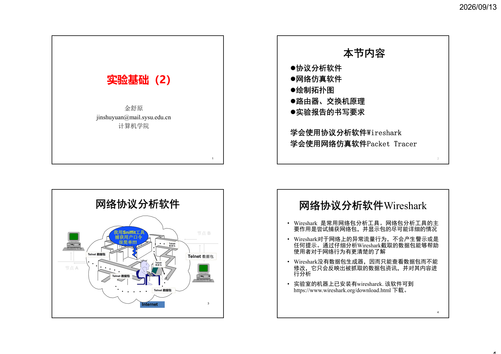

2026/09/13
1
1
实验基础（2）
金舒原
jinshuyuan@mail.sysu.edu.cn
计算机学院
本节内容
协议分析软件
网络仿真软件
绘制拓扑图
路由器、交换机原理
实验报告的书写要求
学会使用协议分析软件Wireshark
学会使用网络仿真软件Packet Tracer
2
Internet
节点A
Telnet 数据包
Telnet 
数据包
我用Sniffit工具
捕获用户口令
很简单!!!
Telnet
数据包
Telnet 数据包
节点B
Telnet 数据包
Telnet 数据包
网络协议分析软件
3
网络协议分析软件Wireshark
• Wireshark 是常用网络包分析工具。网络包分析工具的主
要作用是尝试捕获网络包，并显示包的尽可能详细的情况
• Wireshark对于网络上的异常流量行为，不会产生警示或是
任何提示。通过仔细分析Wireshark截取的数据包能够帮助
使用者对于网络行为有更清楚的了解
• Wireshark没有数据包生成器，因而只能查看数据包而不能
修改，它只会反映出被抓取的数据包资讯，并对其内容进
行分析
• 实验室的机器上已安装有wiresharek. 该软件可到
https://www.wireshark.org/download.html 下载。
4

## 第 2 页

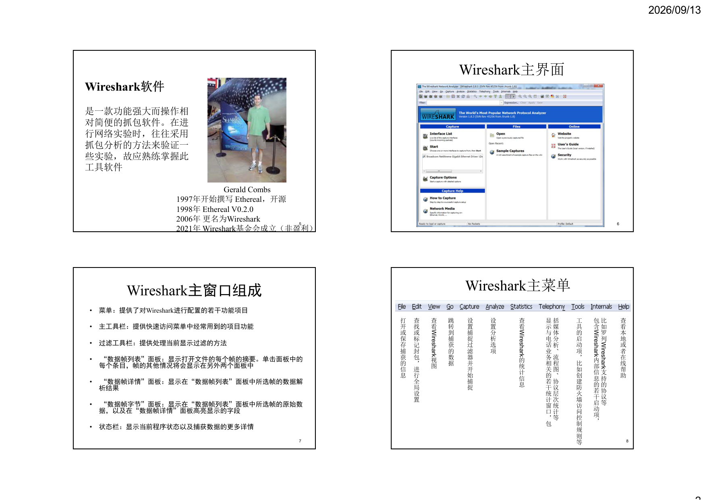

2026/09/13
2
Gerald Combs
1997年开始撰写Ethereal，开源
1998年Ethereal V0.2.0
2006年更名为Wireshark
2021年Wireshark基金会成立（非盈利）
5
Wireshark软件
是一款功能强大而操作相
对简便的抓包软件。在进
行网络实验时，往往采用
抓包分析的方法来验证一
些实验，故应熟练掌握此
工具软件
Wireshark主界面
6
Wireshark主窗口组成
•
菜单：提供了对Wireshark进行配置的若干功能项目
•
主工具栏：提供快速访问菜单中经常用到的项目功能
•
过滤工具栏：提供处理当前显示过滤的方法
•
“数据帧列表”面板：显示打开文件的每个帧的摘要。单击面板中的
每个条目，帧的其他情况将会显示在另外两个面板中
•
“数据帧详情”面板：显示在“数据帧列表”面板中所选帧的数据解
析结果
•
“数据帧字节”面板：显示在“数据帧列表”面板中所选帧的原始数
据，以及在“数据帧详情”面板高亮显示的字段
•
状态栏：显示当前程序状态以及捕获数据的更多详情
7
打
开
或
保
存
捕
获
的
信
息
查
找
或
标
记
封
包
，
进
行
全
局
设
置
查
看
Wireshark
视
图
跳
转
到
捕
获
的
数
据
设
置
捕
捉
过
滤
器
并
开
始
捕
捉
设
置
分
析
选
项
查
看
Wireshark
的
统
计
信
息
查
看
本
地
或
者
在
线
帮
助
括
媒
体
分
析
、
流
程
图
、
协
议
层
次
统
计
等
显
示
与
电
话
业
务
相
关
的
若
干
统
计
窗
口
，
包
工
具
的
启
动
项
，
比
如
创
建
防
火
墙
访
问
控
制
规
则
等
比
如
罗
列
Wireshark
支
持
的
协
议
等
包
含
Wireshark
内
部
信
息
的
若
干
启
动
项
，
Wireshark主菜单
8

## 第 3 页

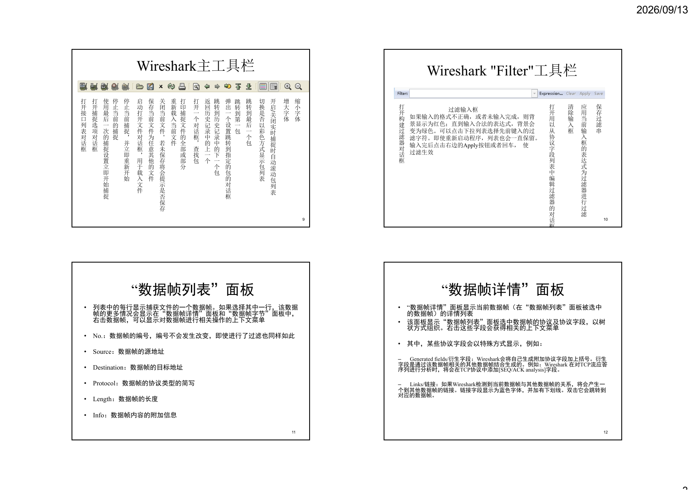

2026/09/13
3
Wireshark主工具栏
打
开
接
口
列
表
对
话
框
打
开
捕
捉
选
项
对
话
框
使
用
最
后
一
次
的
捕
捉
设
置
立
即
开
始
捕
捉
停
止
当
前
的
捕
捉
停
止
当
前
捕
捉
，
并
立
即
重
新
开
始
启
动
打
开
文
件
对
话
框
，
用
于
载
入
文
件
保
存
当
前
文
件
为
任
意
其
他
的
文
件
关
闭
当
前
文
件
。
若
未
保
存
将
会
提
示
是
否
保
存
重
新
载
入
当
前
文
件
打
印
捕
捉
文
件
的
全
部
或
部
分
打
开
一
个
对
话
框
，
查
找
包
返
回
历
史
记
录
中
的
上
一
个
跳
转
到
历
史
记
录
中
的
下
一
个
包
弹
出
一
个
设
置
跳
转
到
指
定
的
包
的
对
话
框
跳
转
到
第
一
包
跳
转
到
最
后
一
个
包
切
换
是
否
以
彩
色
方
式
显
示
包
列
表
开
启
/
关
闭
实
时
捕
捉
时
自
动
滚
动
包
列
表
增
大
字
体
缩
小
字
体
9
Wireshark "Filter"工具栏
打
开
构
建
过
滤
器
对
话
框
过滤输入框
如果输入的格式不正确，或者未输入完成，则背
景显示为红色；直到输入合法的表达式，背景会
变为绿色。可以点击下拉列表选择先前键入的过
滤字符。即使重新启动程序，列表也会一直保留。
输入完后点击右边的Apply按钮或者回车，使
过滤生效
打
开
用
以
从
协
议
字
段
列
表
中
编
辑
过
滤
器
的
对
话
框
清
除
输
入
框
应
用
当
前
输
入
框
的
表
达
式
为
过
滤
器
进
行
过
滤
保
存
过
滤
串
10
“数据帧列表”面板
•
列表中的每行显示捕获文件的一个数据帧。如果选择其中一行，该数据
帧的更多情况会显示在“数据帧详情”面板和“数据帧字节”面板中，
右击数据帧，可以显示对数据帧进行相关操作的上下文菜单
•
No.：数据帧的编号，编号不会发生改变，即使进行了过滤也同样如此
•
Source：数据帧的源地址
•
Destination：数据帧的目标地址
•
Protocol：数据帧的协议类型的简写
•
Length：数据帧的长度
•
Info：数据帧内容的附加信息
11
“数据帧详情”面板
•
“数据帧详情”面板显示当前数据帧（在“数据帧列表”面板被选中
的数据帧）的详情列表
•
该面板显示“数据帧列表”面板选中数据帧的协议及协议字段，以树
状方式组织。右击这些字段会获得相关的上下文菜单
•
其中，某些协议字段会以特殊方式显示，例如：
–
Generated fields/衍生字段：Wireshark会将自己生成附加协议字段加上括号。衍生
字段是通过该数据帧相关的其他数据帧结合生成的。例如：Wireshark 在对TCP流应答
序列进行分析时，将会在TCP协议中添加[SEQ/ACK analysis]字段。
–
Links/链接：如果Wireshark检测到当前数据帧与其他数据帧的关系，将会产生一
个到其他数据帧的链接。链接字段显示为蓝色字体，并加有下划线。双击它会跳转到
对应的数据帧。
12

## 第 4 页

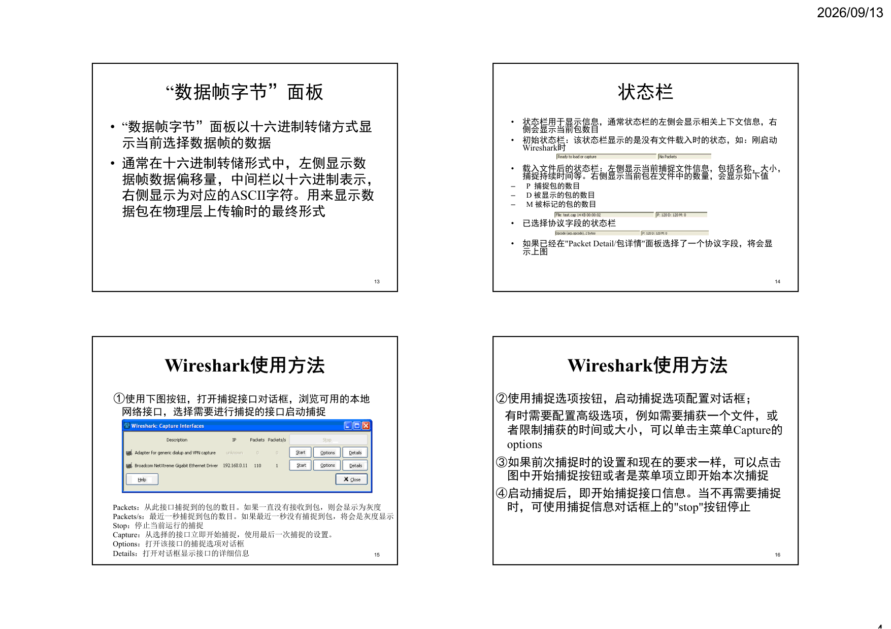

2026/09/13
4
“数据帧字节”面板
• “数据帧字节”面板以十六进制转储方式显
示当前选择数据帧的数据
• 通常在十六进制转储形式中，左侧显示数
据帧数据偏移量，中间栏以十六进制表示，
右侧显示为对应的ASCII字符。用来显示数
据包在物理层上传输时的最终形式
13
状态栏
•
状态栏用于显示信息，通常状态栏的左侧会显示相关上下文信息，右
侧会显示当前包数目
•
初始状态栏：该状态栏显示的是没有文件载入时的状态，如：刚启动
Wireshark时
•
载入文件后的状态栏：左侧显示当前捕捉文件信息，包括名称，大小，
捕捉持续时间等。右侧显示当前包在文件中的数量，会显示如下值
–
P  捕捉包的数目
–
D 被显示的包的数目
–
M 被标记的包的数目
•
已选择协议字段的状态栏
•
如果已经在"Packet Detail/包详情"面板选择了一个协议字段，将会显
示上图
14
Wireshark使用方法
①使用下图按钮，打开捕捉接口对话框，浏览可用的本地
网络接口，选择需要进行捕捉的接口启动捕捉
15
Packets：从此接口捕捉到的包的数目。如果一直没有接收到包，则会显示为灰度
Packets/s：最近一秒捕捉到包的数目。如果最近一秒没有捕捉到包，将会是灰度显示
Stop：停止当前运行的捕捉
Capture：从选择的接口立即开始捕捉，使用最后一次捕捉的设置。
Options：打开该接口的捕捉选项对话框
Details：打开对话框显示接口的详细信息
Wireshark使用方法
②使用捕捉选项按钮，启动捕捉选项配置对话框；
有时需要配置高级选项，例如需要捕获一个文件，或
者限制捕获的时间或大小，可以单击主菜单Capture的
options
③如果前次捕捉时的设置和现在的要求一样，可以点击
图中开始捕捉按钮或者是菜单项立即开始本次捕捉
④启动捕捉后，即开始捕捉接口信息。当不再需要捕捉
时，可使用捕捉信息对话框上的"stop"按钮停止
16

## 第 5 页

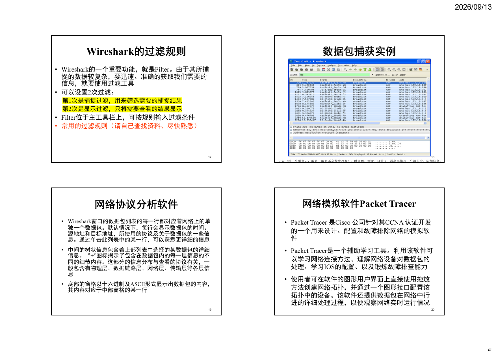

2026/09/13
5
Wireshark的过滤规则
• Wireshark的一个重要功能，就是Filter。由于其所捕
捉的数据较复杂，要迅速、准确的获取我们需要的
信息，就要使用过滤工具
• 可以设置2次过滤：
第1次是捕捉过滤，用来筛选需要的捕捉结果
第2次是显示过滤，只将需要查看的结果显示
• Filter位于主工具栏上，可按规则输入过滤条件
• 常用的过滤规则（请自己查找资料、尽快熟悉）
17
数据包捕获实例
18
分为七列，分别表示：编号（编号不会发生改变）、时间戳、源IP、目的IP、最高层协议、分组长度、附加信息。
网络协议分析软件
• Wireshark窗口的数据包列表的每一行都对应着网络上的单
独一个数据包。默认情况下，每行会显示数据包的时间、
源地址和目标地址，所使用的协议及关于数据包的一些信
息。通过单击此列表中的某一行，可以获悉更详细的信息
• 中间的树状信息包含着上部列表中选择的某数据包的详细
信息。“+”图标揭示了包含在数据包内的每一层信息的不
同的细节内容。这部分的信息分布与查看的协议有关，一
般包含有物理层、数据链路层、网络层、传输层等各层信
息
• 底部的窗格以十六进制及ASCII形式显示出数据包的内容，
其内容对应于中部窗格的某一行
19
网络模拟软件Packet Tracer
• Packet Tracer 是Cisco 公司针对其CCNA 认证开发
的一个用来设计、配置和故障排除网络的模拟软
件
• Packet Tracer是一个辅助学习工具。利用该软件可
以学习网络连接方法、理解网络设备对数据包的
处理、学习IOS的配置、以及锻炼故障排查能力
• 使用者可在软件的图形用户界面上直接使用拖放
方法创建网络拓扑，并通过一个图形接口配置该
拓扑中的设备。该软件还提供数据包在网络中行
进的详细处理过程，以便观察网络实时运行情况
20

## 第 6 页

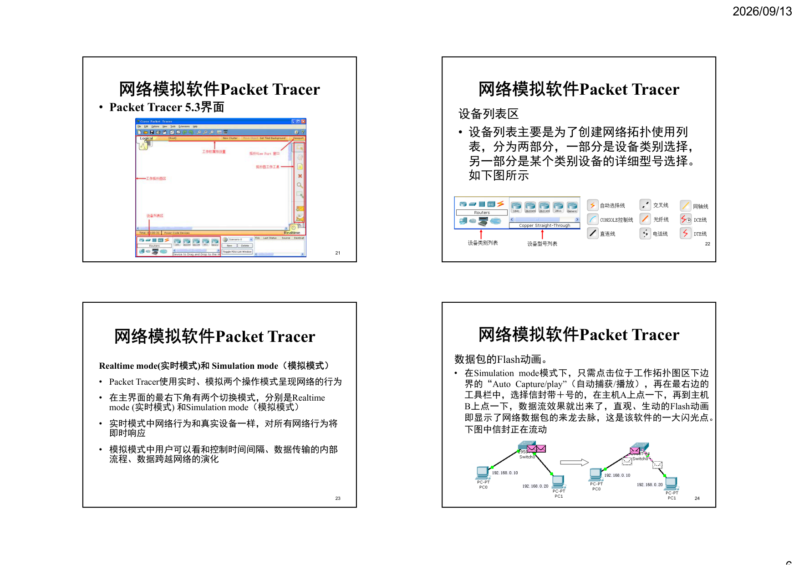

2026/09/13
6
网络模拟软件Packet Tracer
• Packet Tracer 5.3界面
21
网络模拟软件Packet Tracer
设备列表区
• 设备列表主要是为了创建网络拓扑使用列
表，分为两部分，一部分是设备类别选择，
另一部分是某个类别设备的详细型号选择。
如下图所示
22
网络模拟软件Packet Tracer
Realtime mode(实时模式)和Simulation mode（模拟模式）
• Packet Tracer使用实时、模拟两个操作模式呈现网络的行为
• 在主界面的最右下角有两个切换模式，分别是Realtime 
mode (实时模式) 和Simulation mode（模拟模式）
• 实时模式中网络行为和真实设备一样，对所有网络行为将
即时响应
• 模拟模式中用户可以看和控制时间间隔、数据传输的内部
流程、数据跨越网络的演化
23
网络模拟软件Packet Tracer
数据包的Flash动画。
• 在Simulation mode模式下，只需点击位于工作拓扑图区下边
界的“Auto Capture/play”（自动捕获/播放），再在最右边的
工具栏中，选择信封带＋号的，在主机A上点一下，再到主机
B上点一下，数据流效果就出来了，直观、生动的Flash动画
即显示了网络数据包的来龙去脉，这是该软件的一大闪光点。
下图中信封正在流动
24

## 第 7 页

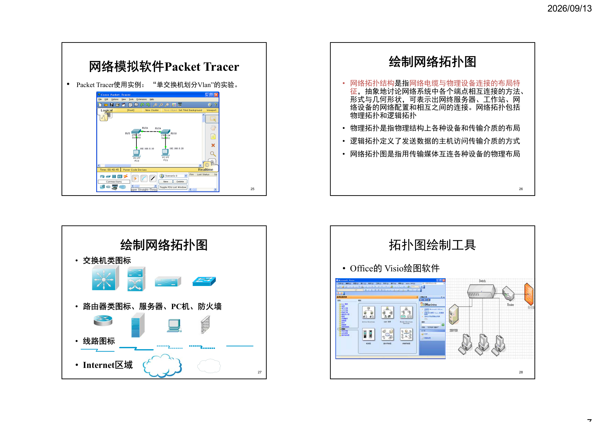

2026/09/13
7
网络模拟软件Packet Tracer
•
Packet Tracer使用实例：“单交换机划分Vlan”的实验。
25
绘制网络拓扑图
• 网络拓扑结构是指网络电缆与物理设备连接的布局特
征，抽象地讨论网络系统中各个端点相互连接的方法、
形式与几何形状，可表示出网终服务器、工作站、网
络设备的网络配置和相互之间的连接。网络拓扑包括
物理拓扑和逻辑拓扑
• 物理拓扑是指物理结构上各种设备和传输介质的布局
• 逻辑拓扑定义了发送数据的主机访问传输介质的方式
• 网络拓扑图是指用传输媒体互连各种设备的物理布局
26
绘制网络拓扑图
• 交换机类图标
• 路由器类图标、服务器、PC机、防火墙
• 线路图标
• Internet区域
27
拓扑图绘制工具
• Office的Visio绘图软件
28

## 第 8 页

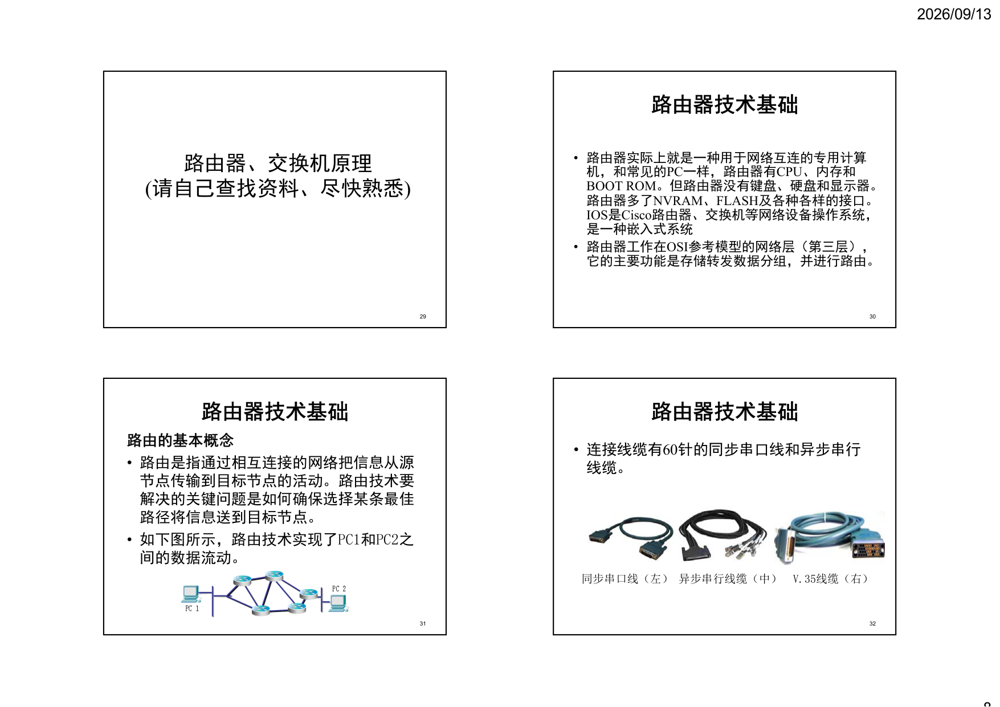

2026/09/13
8
路由器、交换机原理
(请自己查找资料、尽快熟悉)
29
路由器技术基础
• 路由器实际上就是一种用于网络互连的专用计算
机，和常见的PC一样，路由器有CPU、内存和
BOOT ROM。但路由器没有键盘、硬盘和显示器。
路由器多了NVRAM、FLASH及各种各样的接口。
IOS是Cisco路由器、交换机等网络设备操作系统，
是一种嵌入式系统
• 路由器工作在OSI参考模型的网络层（第三层），
它的主要功能是存储转发数据分组，并进行路由。
30
路由器技术基础
路由的基本概念
• 路由是指通过相互连接的网络把信息从源
节点传输到目标节点的活动。路由技术要
解决的关键问题是如何确保选择某条最佳
路径将信息送到目标节点。
• 如下图所示，路由技术实现了PC1和PC2之
间的数据流动。
31
路由器技术基础
• 连接线缆有60针的同步串口线和异步串行
线缆。
32
同步串口线（左）异步串行线缆（中）
V.35线缆（右）

## 第 9 页

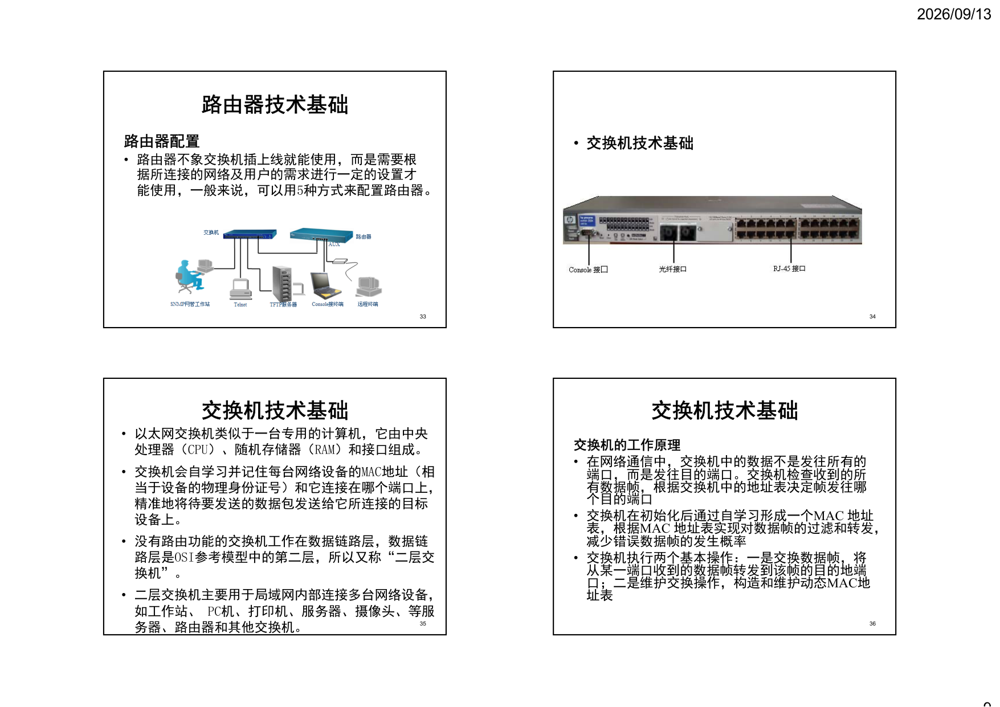

2026/09/13
9
路由器技术基础
路由器配置
• 路由器不象交换机插上线就能使用，而是需要根
据所连接的网络及用户的需求进行一定的设置才
能使用，一般来说，可以用5种方式来配置路由器。
33
• 交换机技术基础
34
交换机技术基础
• 以太网交换机类似于一台专用的计算机，它由中央
处理器（CPU）、随机存储器（RAM）和接口组成。
• 交换机会自学习并记住每台网络设备的MAC地址（相
当于设备的物理身份证号）和它连接在哪个端口上，
精准地将待要发送的数据包发送给它所连接的目标
设备上。
• 没有路由功能的交换机工作在数据链路层，数据链
路层是OSI参考模型中的第二层，所以又称“二层交
换机”。
• 二层交换机主要用于局域网内部连接多台网络设备，
如工作站、PC机、打印机、服务器、摄像头、等服
务器、路由器和其他交换机。
35
交换机技术基础
交换机的工作原理
• 在网络通信中，交换机中的数据不是发往所有的
端口，而是发往目的端口。交换机检查收到的所
有数据帧，根据交换机中的地址表决定帧发往哪
个目的端口
• 交换机在初始化后通过自学习形成一个MAC 地址
表，根据MAC 地址表实现对数据帧的过滤和转发，
减少错误数据帧的发生概率
• 交换机执行两个基本操作：一是交换数据帧，将
从某一端口收到的数据帧转发到该帧的目的地端
口；二是维护交换操作，构造和维护动态MAC地
址表
36

## 第 10 页

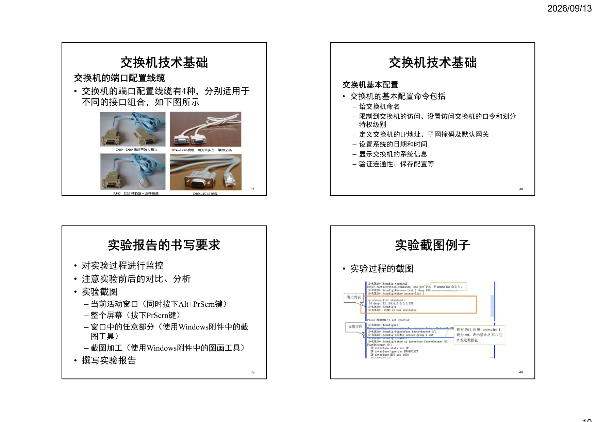

2026/09/13
10
交换机技术基础
交换机的端口配置线缆
• 交换机的端口配置线缆有4种，分别适用于
不同的接口组合，如下图所示
37
交换机技术基础
交换机基本配置
• 交换机的基本配置命令包括
– 给交换机命名
– 限制到交换机的访问、设置访问交换机的口令和划分
特权级别
– 定义交换机的IP地址、子网掩码及默认网关
– 设置系统的日期和时间
– 显示交换机的系统信息
– 验证连通性、保存配置等
38
实验报告的书写要求
• 对实验过程进行监控
• 注意实验前后的对比、分析
• 实验截图
– 当前活动窗口（同时按下Alt+PrScrn键）
– 整个屏幕（按下PrScrn键）
– 窗口中的任意部分（使用Windows附件中的截
图工具）
– 截图加工（使用Windows附件中的图画工具）
• 撰写实验报告
39
实验截图例子
• 实验过程的截图
40

## 第 11 页

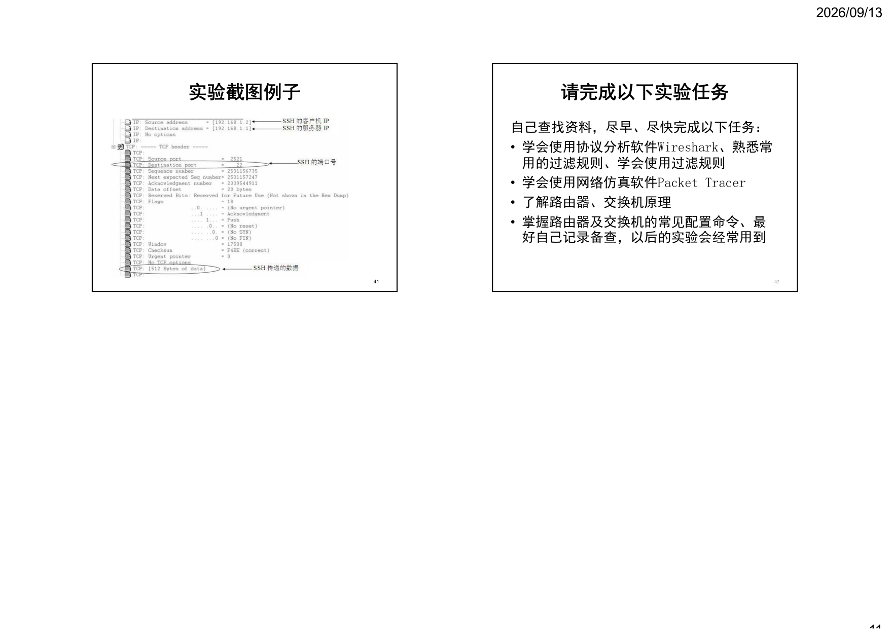

2026/09/13
11
实验截图例子
41
请完成以下实验任务
自己查找资料，尽早、尽快完成以下任务：
• 学会使用协议分析软件Wireshark、熟悉常
用的过滤规则、学会使用过滤规则
• 学会使用网络仿真软件Packet Tracer
• 了解路由器、交换机原理
• 掌握路由器及交换机的常见配置命令、最
好自己记录备查，以后的实验会经常用到
42
