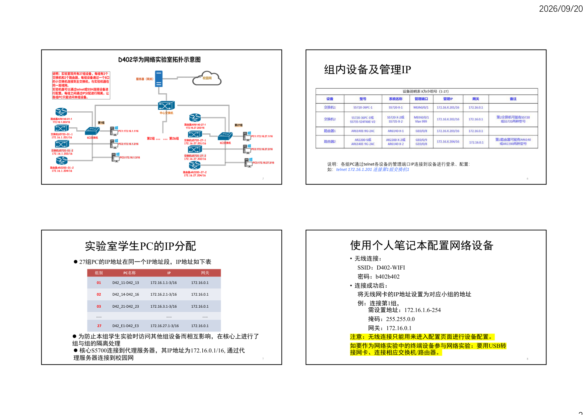
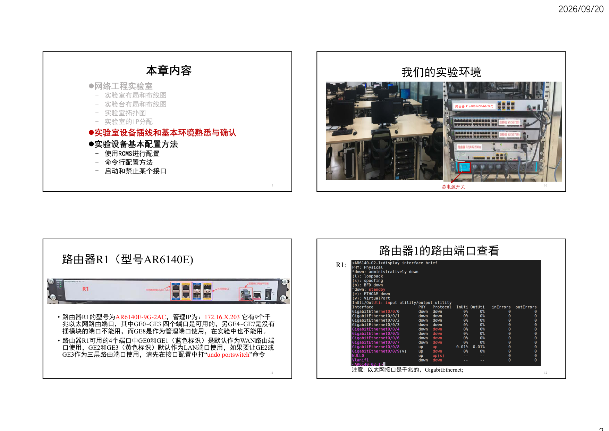
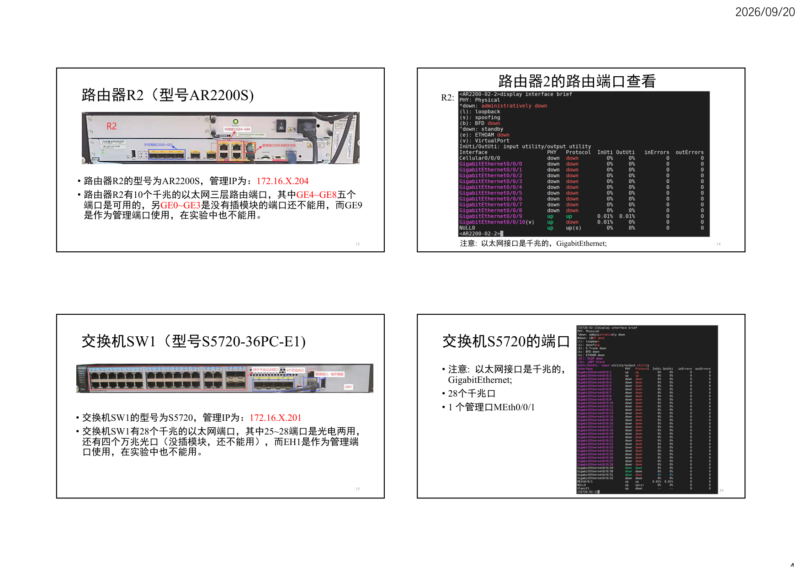
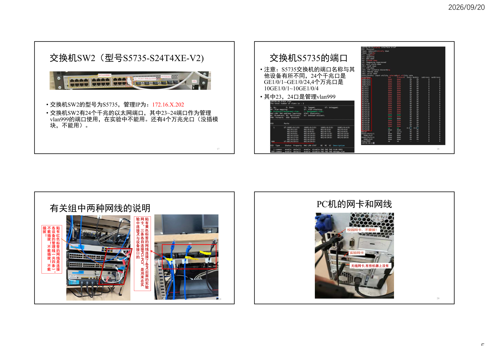

# 实验基础（3）

## 第 1 页

2026/09/20
1
1
实验基础（3）
金舒原
jinshuyuan@mail.sysu.edu.cn
计算机学院
本章内容
网络工程实验室
-
实验室布局和布线图
-
实验台布局和布线图
-
实验室拓扑图
-
实验室的IP分配
实验室设备插线和基本环境熟悉与确认
实验设备基本配置方法
-
命令行配置方法
-
启动和禁止某个接口
2
网络工程实验室
• 实验室共27组基础实验平台，每组包括4台基础网络设备
– 三层交换机S5720-36PC-1/S5735-S24T4XE-V2 2台
– 路由器AR6140E-9G-2AC /AR2200-S 2台
• 每组实验平台配有3台PC，同时控制组与组之间的设备访问
• 每组实验平台使用一个8口的交换机连接到核心交换机
– 连接3台PC
– 连接组内4台基础网络设备（2台交换机+2台路由器）
– 校园网交换机S5700
• 每台PC配有2块网卡
– 1块网卡用于连接实验室的网络设备（连接校园网和各设备管理端口）
– 1块网卡用于搭建实验网络（搭建自己小组要做的网络实验）
3
4
实验室各组分布平面示意图

## 第 2 页

2026/09/20
2
5
组内设备及管理IP 
6
说明：各组PC通过telnet各设备的管理端口IP连接到设备进行登录、配置：
如：telnet 172.16.1.201 连接第1组交换机1
实验室学生PC的IP分配
网关
IP
PC名称
组别
172.16.0.1
172.16.1.1-3/16
D42_11-D42_13
01
172.16.0.1
172.16.2.1-3/16
D42_14-D42_16
02
172.16.0.1
172.16.3.1-3/16
D42_21-D42_23
03
……
……
……
172.16.0.1
172.16.27.1-3/16
D42_E1-D42_E3
27
27组PC的IP地址在同一个IP地址段，IP地址如下表
为防止本组学生实验时访问其他组设备而相互影响，在核心上进行了
组与组的隔离处理
核心S5700连接到代理服务器，其IP地址为172.16.0.1/16, 通过代
理服务器连接到校园网
7
使用个人笔记本配置网络设备
• 无线连接：
SSID：D402-WIFI
密码：b402b402
• 连接成功后：
将无线网卡的IP地址设置为对应小组的地址
例：连接第1组，
需设置地址：172.16.1.6-254
掩码：255.255.0.0
网关：172.16.0.1
注意：无线连接只能用来进入配置页面进行设备配置。
如要作为网络实验中的终端设备参与网络实验：要用USB转
接网卡、连接相应交换机/路由器。
8

## 第 3 页

2026/09/20
3
本章内容
网络工程实验室
-
实验室布局和布线图
-
实验台布局和布线图
-
实验室拓扑图
-
实验室的IP分配
实验室设备插线和基本环境熟悉与确认
实验设备基本配置方法
-
使用RCMS进行配置
-
命令行配置方法
-
启动和禁止某个接口
9
我们的实验环境
10
总电源开关
路由器R1 (AR6140E-9G-2AC)
路由器R1（型号AR6140E)
• 路由器R1的型号为AR6140E-9G-2AC，管理IP为：172.16.X.203 它有9个千
兆以太网路由端口，其中GE0~GE3 四个端口是可用的，另GE4~GE7是没有
插模块的端口不能用，而GE8是作为管理端口使用，在实验中也不能用。
• 路由器R1可用的4个端口中GE0和GE1（蓝色标识）是默认作为WAN路由端
口使用，GE2和GE3（黄色标识）默认作为LAN端口使用，如果要让GE2或
GE3作为三层路由端口使用，请先在接口配置中打“undo portswitch”命令
11
路由器1的路由端口查看
R1:
12
注意: 以太网接口是千兆的，GigabitEthernet;

## 第 4 页

2026/09/20
4
路由器R2（型号AR2200S)
• 路由器R2的型号为AR2200S，管理IP为：172.16.X.204 
• 路由器R2有10个千兆的以太网三层路由端口，其中GE4~GE8五个
端口是可用的，另GE0~GE3是没有插模块的端口还不能用，而GE9
是作为管理端口使用，在实验中也不能用。
13
路由器2的路由端口查看
R2:
14
注意: 以太网接口是千兆的，GigabitEthernet;
交换机SW1（型号S5720-36PC-E1)
• 交换机SW1的型号为S5720，管理IP为：172.16.X.201 
• 交换机SW1有28个千兆的以太网端口，其中25~28端口是光电两用，
还有四个万兆光口（没插模块，还不能用），而EH1是作为管理端
口使用，在实验中也不能用。
15
交换机S5720的端口
• 注意:  以太网接口是千兆的，
GigabitEthernet;
• 28个千兆口
• 1 个管理口MEth0/0/1
16

## 第 5 页

2026/09/20
5
交换机SW2（型号S5735-S24T4XE-V2)
• 交换机SW2的型号为S5735，管理IP为：172.16.X.202 
• 交换机SW2有24个千兆的以太网端口，其中23~24端口作为管理
vlan999的端口使用，在实验中不能用。还有4个万兆光口（没插模
块，不能用）。
17
交换机S5735的端口
• 注意：S5735交换机的端口名称与其
他设备有所不同，24个千兆口是
GE1/0/1~GE1/0/24,4个万兆口是
10GE1/0/1~10GE1/0/4
• 其中23，24口是管理vlan999
18
有关组中两种网线的说明
19
贴
有
红
色
标
签
的
网
线
是
连
接
各
设
备
的
管
理
线
（
共
四
条
）
，
不
能
插
拔
！
不
能
插
拔
！
不
能
插
拔
！
贴
有
黄
色
标
签
的
网
线
连
接
了
各
PC
后
面
的
实
验
网
卡
，
三
条
各
自
连
接
PC1-PC3
，
是
用
来
在
实
验
中
连
接
PC
与
设
备
接
口
的
PC机的网卡和网线
20
无线网卡,有些机器上没有

## 第 6 页

2026/09/20
6
本章内容
网络工程实验室
-
实验室布局和布线图
-
实验台布局和布线图
-
实验室拓扑图
-
实验室的IP分配
实验室设备插线和基本环境熟悉与确认
实验设备基本配置方法
-
设备配置-连接登录
-
命令行配置方法
-
启动和禁止某个接口
21
设备连接登录步骤
22
1
2
3
4
Username:user
Password: b402b402 （密码没有回显）
4
交换机、路由器登录连接
我们的设备要用telnet或SSH连接登录，因此须先安装
SecureCRT或telnet 客户端
每台PC都装有SecureCRT和MobaXterm_Personal_22.1
登录设备，进入用户VIEW < >
telnet 各设备管理IP 172.16.X.20* （X为小组号：1~27，*为设备号1~4）
例：telnet 172.16.2.201 连接第2组交换机1
Username:user
Password: b402b402 （密码没有回显）
进入系统配置VIEW [ ]
<s5720-02-1>system-view
[s5720-02-1]
23
使用MobaXterm登录设备过程示例
实验设备配置VIEW
• 设备登录完成后进入的是普通用户user view：<>
在该view中进行基本测试、显示系统信息
• system view：[]
使用system-view命令后的配置影响整个设备的全局参数
• 不同的VIEW对应不同的命令集，只有进入了相关的VIEW后才可
以执行相应的配置命令
24

## 第 7 页

2026/09/20
7
实验设备基本配置
• 子view
• 线路配置view ([R1] user-interface vty 0)
• [R2-ui-vty0]
配置路由器的线路参数
• 接口配置view ([R2] interface gigabitethernet0/0/1 )
[R2-GigabitEthernet0/0/1]
配置路由器的接口参数
• 显示某视图下有什么命令：
•
[R2-ui-vty0] ？
•
[R2-ui-vty0] display this
• [R2-ui-vty0] disp?
25
实验设备基本配置
给设备重新命名
- [s5720-02-1]sysname value
- 注：value为要命名设备的名称
例：把交换机名称设为sysu
- 执行前
- [s5720-02-1]sysname sysu
- 执行后
• [sysu]
26
命令行其他功能
（1）获得帮助
[switch]?
[switch]display ?
使用“？”获得帮助，当某个命令只记得一部分时，在记得部分后输入“？”（无空格），可以查看
到以此字母开头的所有可能命令；当不了解在某模式下有哪些命令是，可以输入“？”，可以查看到
此模式下所有命令；当不清楚某单词后可输入的命令时可在此单词后输入“？”（中间有空格）
（2）命令简写
全写：[switch] interface GigabitEthernet 0/0/1
简写：[Switch] int g0/0/1
要注意的是这种简写能识别出唯一命令
（3）使用历史命令
用键盘上的向上向下方向键可以调出曾经输入的历史命令，并可以通过上下键上下选择
[Switch](向上键) 
[Switch](向下键) 
27
• 端口前缀（如“Ethernet”或“GigabitEthernet”）表示端口类型（如百兆或千兆以太网）
• 交换机/路由器等设备上端口标识“0/0/1”是一种常见的层次化命名格式，用于在命令行
中唯一指定设备上的物理或逻辑端口。该格式通常表示为“设备号/板卡号/端口号”，每
个部分含义如下：
– 设备号（第一个数字“0”） ：表示设备索引（device number），在单台交换机配置中通
常为0，代表本地设备本身。
– 板卡号（第二个数字“0”） ：表示板卡或槽位索引（slot/module number），如果交换机
无扩展槽位（如固定端口设备），则此数字可能固定为0。
– 端口号（第三个数字“1”） ：表示该板卡上的具体端口索引（port number），通常从1开
始计数，对应物理端口的顺序位置。
• 在实际设备上，物理端口一般使用端口号标识，设备号和板卡号主要用于命令行配置
和管理、用以区分不同层级的硬件结构。
接口编号的标识规则
28

## 第 8 页

2026/09/20
8
启用/禁止接口
• 接口的两种状态：up和down
当端口被关闭时，端口的管理状态为down，否则为up
例子1：关闭交换机的接口gigabitethernet 0/0/2：
[Switch]interface gigabitethernet 0/0/2 
[Switch-gigabitethernet 0/0/2]shutdown
• 重新启动一个接口,使用undo
[Switch-gigabitethernet 0/0/2]undo shutdown
注意：实验过程中，应适时display interface brief检查所用接口的状态，需保证实验所使用的
端口为UP状态（若是down的状态，请通过undo shutdown命令设置为up状态)。
29
一键清功能
• 所谓“一键清”，是指使用一条指令，即可把小组中所有的网
络设备的配置恢复到当初缺省配置，提供一个干净的环境给下
一组学生作实验。
• 实验结束后，应将实验时对设备的配置清除，以免影响下一批
的学生配置设备。
• 我们提供了一个名为clear.py的python脚本，可以运行该脚本来
进行一键清。
30
1)须先安装python
实验室每台PC都装有python 3.10
2) 在CMD命令提示符窗口里，输入命令：
python clear.py x
参数x为组号,  执行一键清（clear.py在PC机的MobaXterm目录下）
clear.py脚本执行完成后，相应X组各设备会自动热重启，重启后，设备就恢复到原配置
3)注意事项：
1、运行此脚本前要保证所有设备连接都已经关闭。
2、由于设备热重启过程比较慢（5~10分钟），因此在实验过程中如非必要
尽量不要用此功能。如有打错命令、功能配置出错等，可以用‘undo +相应
命令’进行取消命令、复原配置。
3、如果只想清除其中一个设备，可以在该设备用户view，输入命令“reboot 
fast”重启设备。
4、关闭电源、实验中所作的所有配置也会丢失。
进行一键清（设备热重启）操作步骤
31
网络实验室注意事项
1.请同学们做实验时，不要随意插拔网络设备上的线缆，包括：管理网线、Console线、校园
网线
2.做完实验后请关闭电脑、关闭网络设备电源、把网线整理好还回放置处！
3.离开实验室时请把纸巾、饮料瓶等垃圾带走，不要遗漏个人物品！
4. 实验室现在的系统是win10 ，没有telnet 客户端和服务器，均提供了第三方的工具
MobaXterm_Personal_22.1可以使用，自己安装在实验室PC上的软件在机器重启后会被清除。
5.实验室里的路由器和交换机由于历史原因有不同的型号和配置，所以有些组的路由器/交换
机的端口名称和编号可能会不一样，做实验前最好先查看设备的接口情况（用display 
interface brief命令），做实验时要根据实际情况使用恰当命令进行相应配置。
32

## 第 9 页

2026/09/20
9
请完成以下实验任务
• 通过PC上的MobaXterm、或者自己笔记本上的telnet 访问华为网络设
备，熟悉实验室的路由器和交换机设备的相关配置
(1)练习查看交换机、路由器所有接口状态、启动或关闭某一接口、修改路由器
和交换机的名字、查看正在运行的接口状态等命令
(2)假设你是某公司新网管，第1天上班，你必须掌握公司路由器的当前工作情
况，了解公司的网络设备和网络环境，查看路由器的配置信息、路由器当前生
效的配置信息、系统信息、路由信息等，请给出完成该任务所需的命令。
备注：若实验室已安装的MobaXterm需要密码，请网上下载重新安装
• 实验结束时，请使用一键清或者关闭电源
注意：关闭电源后、实验中所作的配置将丢失。
33
